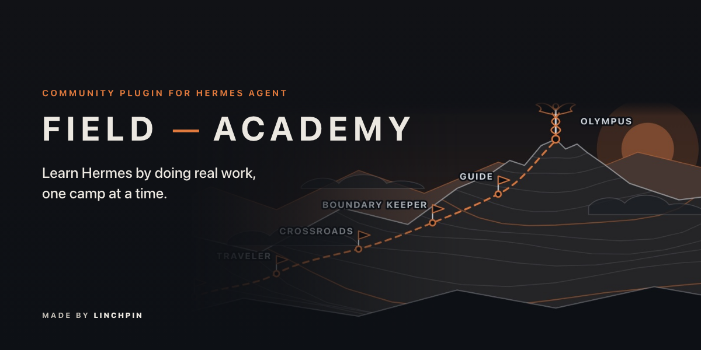
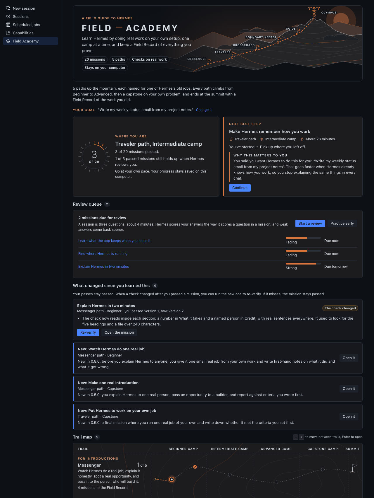
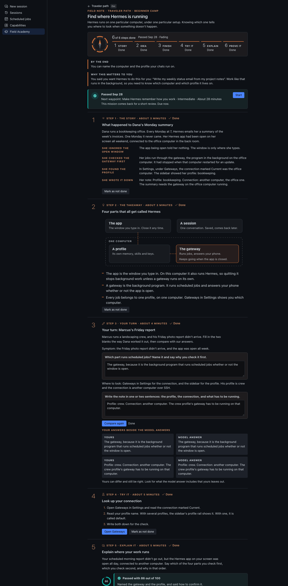
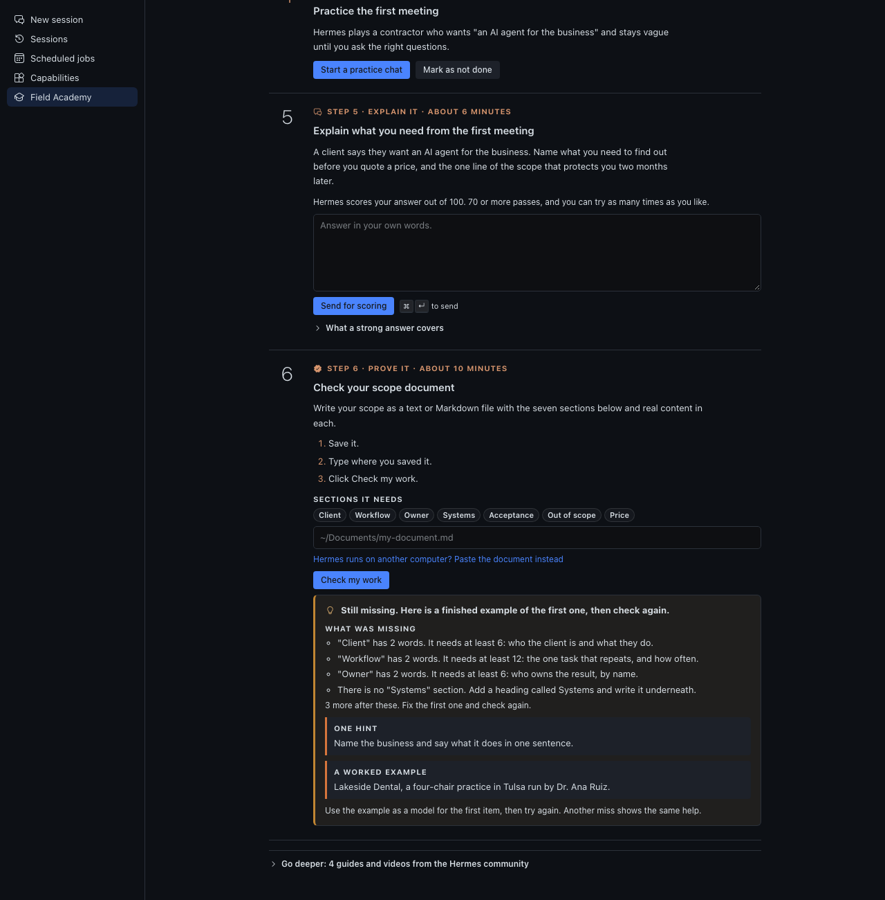
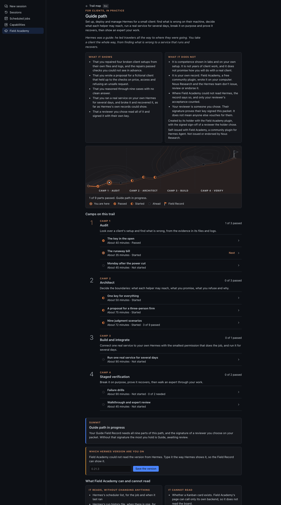
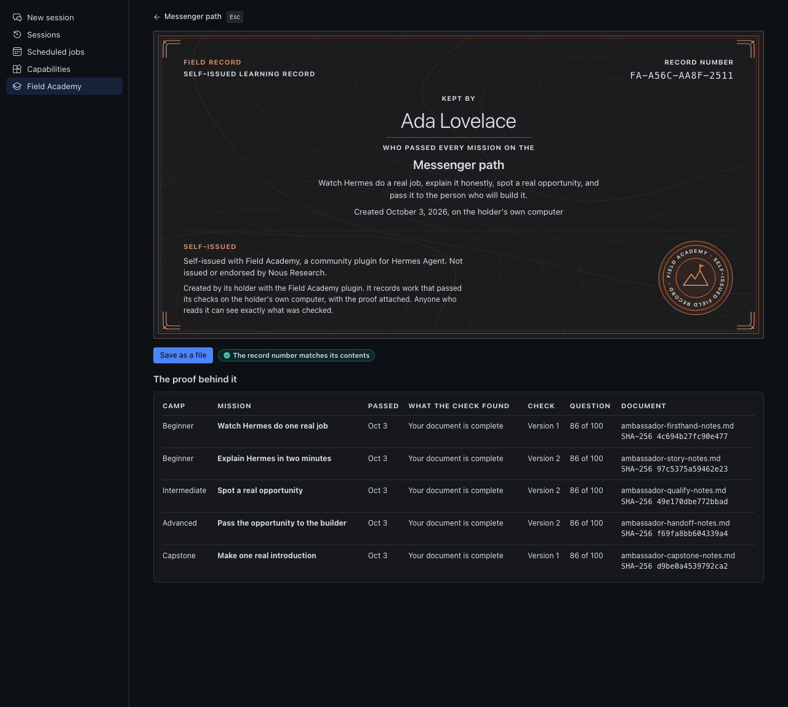

# Field Academy

A Hermes Desktop plugin for learning Hermes Agent by doing real work on your own setup, with checks that read
what you made and a Field Record you keep for each path. Free, MIT licensed, and everything stays on your computer.

Field Academy is a community plugin by Damon Gardenhire. Nous Research didn't make it and doesn't issue, review or
endorse it or the records it writes.



**[Read the manual](docs/MANUAL.md)**: every path, mission and check, step by step, with screenshots.



Reviewing it? Start with [REVIEWER-GUIDE.md](REVIEWER-GUIDE.md), a ten-minute tour. Who each path is for and what
each check really reads: [docs/paths.md](docs/paths.md).

| | |
|---|---|
|  |  |
|  |  |


## What you see

Click **Field Academy** under **Tools** in the sidebar and the page opens on Mount Olympus: a banner with a band of cloud on the
mountain's shoulders, one flag per path, and the caduceus, the herald's staff, at the summit. The paths take their
names from Hermes's old jobs, and each path page says in one line why its name fits. Four learning paths come first:

- **Messenger**, for introductions: watch Hermes do one real job, explain it honestly, spot a real opportunity, and pass it to the builder. Hermes carried word between the gods and people.
- **Traveler**, for yourself: run Hermes on your own computer and keep one daily job working. Hermes protected travelers.
- **Crossroads**, for clients: set Hermes up for a client, connect it to their tools, and hand it over. Hermes was the god of crossroads.
- **Boundary Keeper**, for an organization: who owns what, who approves what, and how it recovers. Herms, stone pillars, marked where one property ended and the next began.

A fifth, **Guide**, sits below them for people who will deploy and run Hermes for a client; Hermes led travelers to
where they were going. It is described under [The Guide path](#the-guide-path).

Each learning path climbs three levels, **Beginner**, **Intermediate** and **Advanced** (the level names Nous uses on its Learning Path page), then ends with a **Capstone** on your own problem. The map shows where you are on each path and how many missions stand between you and its Field Record. A **Start here** card picks your next mission and says why it matters to you and how long it takes. For a new learner that is the first Messenger mission, **Watch Hermes do one real job**.

Above the map, the first time you open it, one question: **What do you want Hermes to do for you?** Your answer becomes the example in every practice prompt and the "Why this matters to you" line on every mission. You can change it, or skip it.

Saved progress from earlier versions keeps working: the paths' internal ids (`ambassador`, `operator`, `integrator`, `architect`, and the Guide path's `deployer`) did not change with their names.

## A mission

Twenty missions across the four learning paths (sixteen, plus a capstone on each). Support fades as you go. Each mission has six steps, with plain names:

1. **The story.** A short case of what happened to someone, with its steps labelled.
2. **The takeaway.** The idea in a few lines (three, in a story-first mission), with a labelled picture where one helps (Find where Hermes is running shows the four parts of Hermes).
3. **Your turn.** A half-done example with gaps. You write each gap first, and the model answer shows after you try.
4. **Try it** in your own Hermes, on your own. A button opens the right page, or opens a new chat and sends the practice prompt for you.
5. **Explain it** in your own words. Hermes scores the answer in a new chat of its own, so the scoring never lands in the middle of your own work; 70 or more passes.
6. **Prove it.** Every check needs something you made: a typed answer compared with what Hermes reports, a skill or job or chat carrying a marker (`academy-...`, `[FA-DESKTOP]`), or a document whose every section holds real content. A few checks can only confirm that the thing you made exists with the mission's name (the skill check is one); [docs/checks.md](docs/checks.md) and [docs/paths.md](docs/paths.md) list each check and say which ones cannot be made fully strong. If your Hermes runs on another computer, paste a document instead of typing where it is saved.

Everything you need to pass is on the page. Reading and video links from the Hermes docs and the people who teach Hermes sit at the end of each mission, closed, under **Go deeper**.

**No copy and paste.** Practice prompts and scoring requests open a new chat and send themselves. The clipboard is used only on a Hermes too old to allow that, and the page says so when it happens.

**When you miss**, the page says exactly what was missing and gives one hint. A second miss adds a worked example. You can always retry.

**Time.** Every mission and every step says how long it takes, in honest working minutes. The top of a mission stays short so you reach step one quickly.

## Review

Two days after you pass a mission, it comes back for a short review: three questions drawn from missions you passed earlier, scored by your own Hermes the way an explain-it answer is. Answer well and the next review waits a week, then three weeks, then two months. Answer badly and it comes back tomorrow. Each mission keeps a strength (Strong, Holding, Fading, Weak) shown on the map. The **Review queue** on the home screen lists what is due. Nothing counts your days or sets a daily goal.

## Placement

Each path has a six-question placement check. Get both questions right on a level and you can skip that level's reading and practice. **Skipped levels still need you to answer each question and pass each check**, and your Field Record says which missions had their reading skipped.

## After the summit

**What changed since you learned this** lists missions whose lesson or check changed after you passed them, in plain words, with a **Re-verify** button. Your passes stay passed whatever a re-verify finds, and your Field Record says which version of each check you passed.

## Your Field Record

A Field Record is your own learning record for a path. You build it mission by mission, and when every mission on the path passes, including the capstone, you type your name and Field Academy writes it on your computer. It carries your name, the date, and the proof behind every mission:

- What each check found, and the version of the check
- Your score on each question
- The file name and fingerprint of each document you wrote

It never holds your answers, your chats, or full file paths.

The record number is the first 12 characters of a SHA-256 over the record's own contents, so an accidental edit stops matching. It is not a signature: someone editing their own data on purpose can rebuild it. **Save as a file** writes a readable `.md` and a matching `.json` to a `field-records` folder in Field Academy's data folder.

Every Field Record, on screen and in both files, carries this line:

> Self-issued with Field Academy, a community plugin for Hermes Agent. Not issued or endorsed by Nous Research.

It records checks that passed on one computer, and it is yours to keep, share or leave alone. Records made by 0.8.2 and earlier were called certificates; they keep their original stored wording, because the record number covers it, and they still verify.

## The Guide path

A fifth trail, below the four on the map, for one question the others do not ask: can this person set up, deploy
and manage Hermes for a small client, a solopreneur or a three-person firm? It is not a course. It makes you do the
work, in four camps that follow the order a deployment goes in (audit, architect, build and integrate, staged
verification):

1. **Four break-and-fix labs** (Audit and Architect). Field Academy builds a disposable "client machine" as a
   plain folder of fake files that imitates a Hermes home: settings, a keys file with clearly fake keys, scheduled
   jobs, logs, a profile folder, a service file and a backup script. One fault is hidden in it. You open the folder
   (the page has an **Open the folder** button), read the logs, repair the files, and write down what happened. A
   script grades the files and your write-up against criteria you cannot see, and a miss gives you what was
   missing, one hint, then a worked example. The four labs: a key leaked into a saved settings file that must be
   moved, rotated and recorded; a scheduled job running every minute on an expensive model that needs a sane
   schedule and a cost cap; a service that does not survive a reboot, with open file permissions and a backup that
   never ran; and one key shared by two helpers that needs a key each, with the smallest scopes and a rotation
   note. The cases come from a seed, so a repair copied from someone else fails on yours.
2. **A client proposal** (Architect). A vague brief from a fictional three-person accounting firm, with a budget,
   constraints and one request that should be refused. You write scope, price, acceptance criteria, what you
   would audit first, what the helper may reach, the build, how you test before go-live, who approves what, the
   request you decline, and the handover. A script checks the numbers, the named owner, the access list and the
   refusal. Your own Hermes scores the prose against a rubric you see afterwards.
3. **Nine judgment scenarios** (Architect). Cases with no clean answer: emailing customers on its own, a shared
   login, a compliance claim, chasing a customer in hardship, scope creep into payroll, an update before month
   end, watching staff, a handover from a relative, and connecting a community tool. Scored on reasoning, not on a
   verdict.
4. **A real deployment** (Build and integrate). You connect one real service to your own Hermes with the smallest
   permission and let a scheduled job use it for at least three days. Field Academy reads Hermes's own scheduler
   list, run history and logs, read only, and checks that it ran over time.
5. **Failure drills** (Staged verification). You revoke a token, trip a rate limit or restart Hermes, then prove
   recovery with timestamps that show a gap and a recovered run. The drill is yours to run on your own setup.
   Nothing is run for you.
6. **A walkthrough and a review.** You explain one lab as you would to a client's partner. Field Academy
   gathers everything into a review packet (all the evidence, fingerprints, your recorded explanation) with a
   rubric. A reviewer you choose, someone with the experience to judge it, reads it and signs a JSON file the
   plugin verifies. Without the signature you hold **Guide, awaiting review**. With it you create your **Guide
   Field Record**.

The Guide Field Record shows the Hermes version it was made on and shows **Re-verify needed** when that version moves
to a new series. Re-verify repeats the four labs on new cases.

**What it shows:** competence shown in labs and on your own setup, with the signature of a reviewer you chose.
**What it does not:** years of client work, or how you will do with a real client. Like every Field Record, it is
self-issued, and Nous Research and the Hermes team don't issue, review or endorse it. Where Field Academy could not
read Hermes, the screen says so and the part falls back to a packet the reviewer checks. Your own word alone never
passes. The path's order follows the lifecycle Tony Simons describes at tonysimons.dev;
he has not reviewed it and does not endorse it, and his site offers no certification.

Labs are folders of files under Field Academy's own data folder. Nothing in one runs, Hermes never reads it,
every key in it is fake, and a test fails if the real `~/.hermes` changes. Reviewers: see
[docs/reviewing.md](docs/reviewing.md). The research behind the design, and the claims that could not be verified:
[docs/deployer-pedagogy.md](docs/deployer-pedagogy.md).

## Install

You need Hermes Desktop with Hermes Agent 0.22.0 or newer. This release was checked against the Hermes 0.22.0
source.

1. Install it from Hermes Desktop: open the link
   [hermes://plugin/install?catalog=field-academy](hermes://plugin/install?catalog=field-academy), or click
   **Capabilities**, then **Plugins**, find Field Academy and click **Install**.

   Prefer the terminal? On the computer where Hermes runs (PowerShell on Windows), type:

   ```bash
   hermes plugins install Dgardenhire/hermes-field-academy --enable
   ```

   Hermes downloads the plugin and switches it on. (Without `--enable` it asks "Enable 'field-academy' now?"; answer y.)
2. Restart Hermes, or in the app press Cmd-K (Ctrl-K on Windows and Linux) and choose **Reload desktop plugins**.
3. Click **Field Academy** under **Tools** in the sidebar. The page opens on the trail map and asks one question: what you want
   Hermes to do for you. Answer it and press **Save my goal**, or press **Skip for now**.

To remove it: `hermes plugins remove field-academy`, then delete `~/.hermes/plugin-data/field-academy/` if you want
your progress gone too.

The window half loads from `~/.hermes/desktop-plugins/field-academy/`; the half that stores progress loads from
`~/.hermes/plugins/field-academy/` and only runs while the plugin is enabled. `/academy` in the terminal or a
messaging app prints the same map as plain text.

## What is verified, and what is not

Tested here, without a live Hermes: the full test suite (Python and Node), every screen through the harness in
light, dark and narrow widths, every check against Hermes's own source for the response shapes it reads (skills,
scheduled jobs, sessions, tools, connections), and every lesson against the Hermes 0.22.0 source and docs
(October 15, 2026; the 0.8.1 entry in CHANGELOG.md lists what changed).

Not tested here:

- **A live Hermes Desktop install.** The page and the checks were driven through a stand-in for the plugin SDK
  that serves the real backend. The response shapes come from reading Hermes's source, not from a running app.
- **Learners.** Nobody outside the author has taken a path yet.
- **The Guide path's real-deployment and drill reading** against a live Hermes's run history and logs.
- **Page routes** the missions open (Gateways, Scheduled jobs, Profiles, Kanban) were read from Hermes's source,
  not clicked in a live app. Kanban ships switched off; turn it on under Capabilities, Plugins.

## Privacy

Field Academy sends nothing anywhere. It has no server, no analytics and no account. It reads Hermes through the
app's own connection and writes only to its own data folder. Details below and in [docs/privacy.md](docs/privacy.md).

## What it stores

Progress lives in the plugin's own SQLite database under your Hermes home: for the Guide path, your lab seeds and results, your written answers, run times read from Hermes (times only), your review packet and the sign-off; and for the other paths, step status, check results, question scores, your gap answers, your review answers and strengths, your placement results, your goal, the path and hash of any document you checked, and the Field Records you created. It doesn't record prompts, tool output, credentials or customer data. When 0.5.0 first opens a database from an older version, it copies the whole database to a `backups` folder beside it, then only adds tables and columns. [docs/privacy.md](docs/privacy.md) has the full list.

Delete `~/.hermes/plugin-data/field-academy/` to start over.

## Working alongside Hermes

The plugin ships an agent skill and tools. `field_academy_snapshot` returns a compact status; `field_academy_mission` returns one mission in full; `field_academy_grade_explanation` and `field_academy_grade_review` record the scores Hermes gives. Tool use may suggest a relevant mission. It never advances a step and never counts as evidence, and the suggestion is suppressed outside an interactive session.

## Teaching content

The words that make the learning design work (worked examples, hints, review questions, placement, capstones) live in `content/`, one file per path. The format is in [docs/content-format.md](docs/content-format.md), and the research behind it is in [docs/pedagogy.md](docs/pedagogy.md).

## Building the page

The page Hermes loads, `desktop/plugin.js`, is built from `desktop/src/plugin.js` and the shared design kit (hermes-ui-kit, a sibling folder) with esbuild: `node ../hermes-ui-kit/scripts/build.mjs .`. Edit the source, then build. The built file still imports only `@hermes/plugin-sdk`, `react` and `react/jsx-runtime`.

## Seeing every screen without Hermes

```bash
python3 harness/make_fixtures.py         # real backend, throwaway data folder
python3 harness/shoot.py --list
python3 harness/shoot.py map path-ladder  # one headless Chrome at a time
python3 scripts/check_content.py          # validates content/ against docs/content-format.md
```

PNGs land in `harness/shots/`. The harness stands in for the Hermes SDK and needs network for its CDN imports. It runs no `hermes` command.

## Honest limits

- **Local checks have a local boundary.** Anyone willing to edit their own plugin data, or to send the backend a made-up check result, can fake a pass. Checks that read Hermes run in the page, and the page reports what it found. Document checks are harder to fake because the fingerprint binds the record to a file, and the record number binds the Field Record to its contents, but this is a practice tool run on your own computer.
- **The explain step is scored by your own Hermes.** The rubric is fixed and shown after you answer, but the model doing the scoring is yours, so a learner who tells it what score to give can get that score. Scores arrive only through the agent tools; no web route writes one.
- **You choose your reviewer.** Field Academy's published reviewer list ships empty. A learner adds the key of a reviewer they chose to their own list, and the Field Record says the key came from that list. Nobody at Nous Research or on the Hermes team appoints or approves reviewers.
- **Some checks are still limited.** The marker proves a chat, skill or job exists with the mission's name. It can't prove you did every step in it. Nothing can see whether an approval prompt appeared or whether a Kanban card exists, so those records are your own account, held to specifics. docs/checks.md says which and why.
- **Nothing here is tested on learners.** The design follows learning research, and docs/pedagogy.md says which numbers are our own choices and which claims could not be verified.
- **The Guide path was not run against a live Hermes.** The layout of Hermes's run history and logs is read generously and could not be checked here, and the Hermes version is read from Hermes's install stamp (or, failing that, package metadata) when it can be, and otherwise typed by you. The lab files imitate a Hermes home and are not a copy of one.
- **The reviewer's signature proves the key, not the person.** The plugin verifies a signed sign-off against a list of trusted keys. A learner who edits their own copy can trust their own key, so the Field Record says which list the key came from, and a third party should check it against the published list in the repository.
- **Remote backends read their own disk.** On a remote or Cloud backend, the file path you type means a path on that machine.

## Credits

The teaching this is built on comes from other people: the Nous Research Hermes docs, Tonbi's masterclass (linked through Kevin Simback's Hermes Atlas), Kevin Simback's Hermes Atlas guides, iamlukethedev's Hermes Bible, and Tony Simons, whose site tonysimons.dev is also the reference for the shape of the Guide path. See [CREDITS.md](CREDITS.md).

## License

MIT. See [LICENSE](LICENSE).
