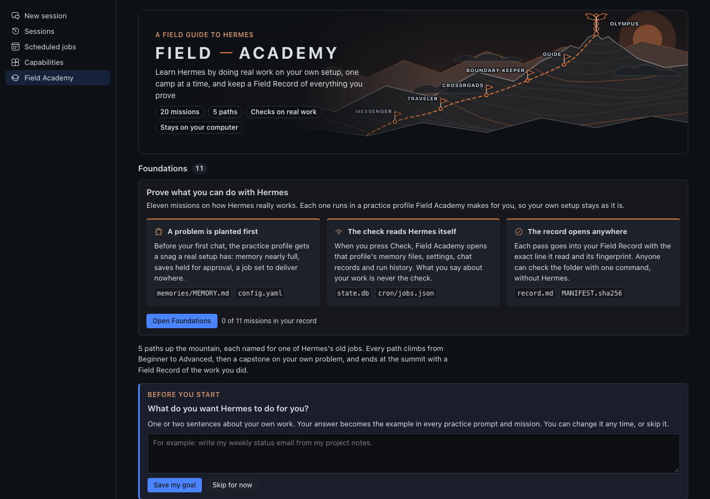
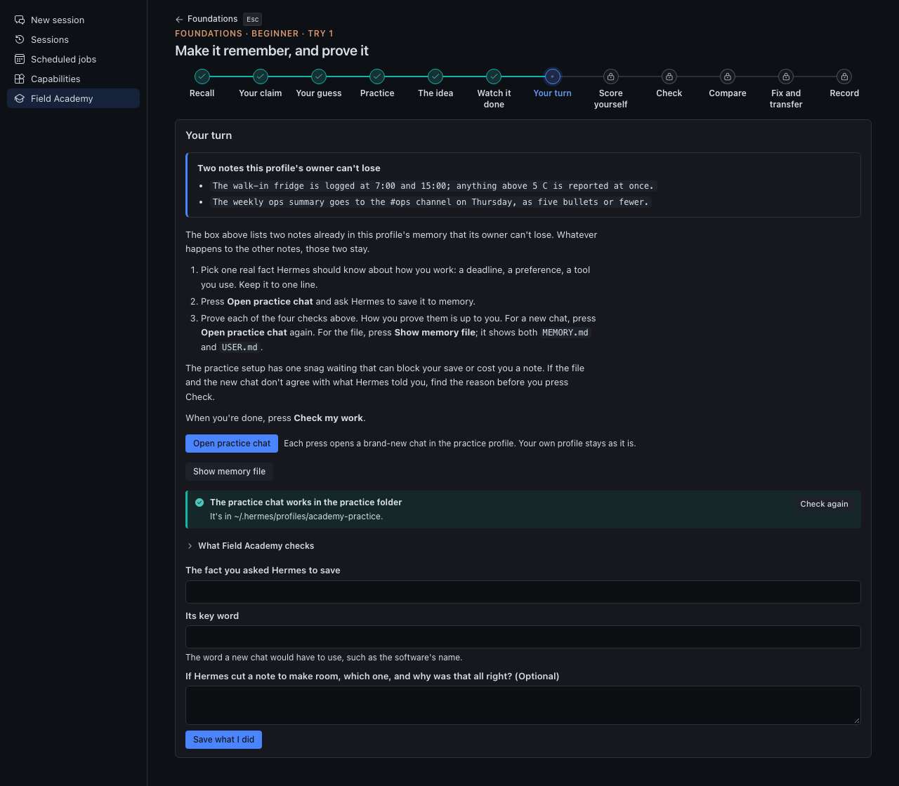
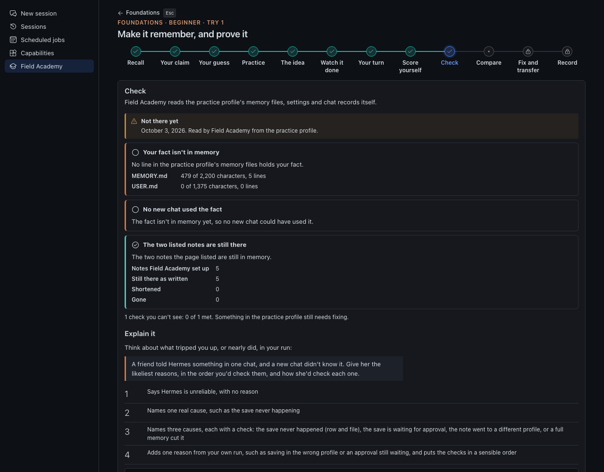
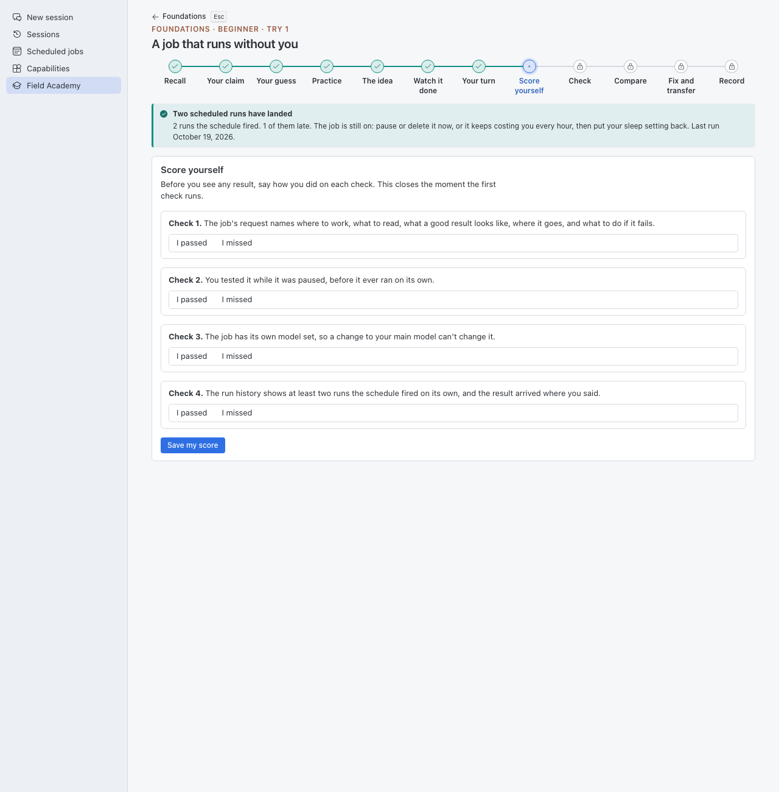
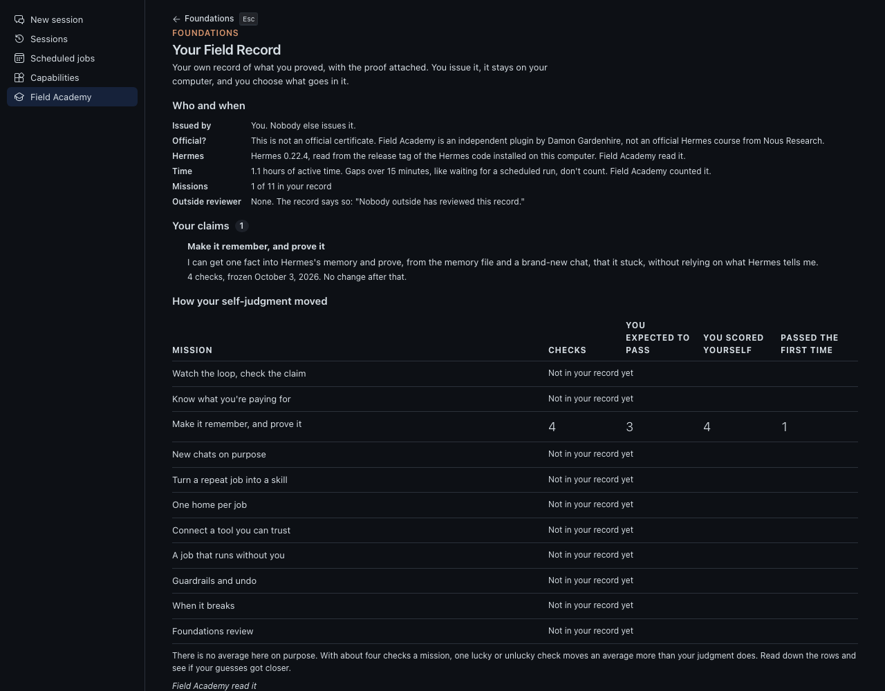
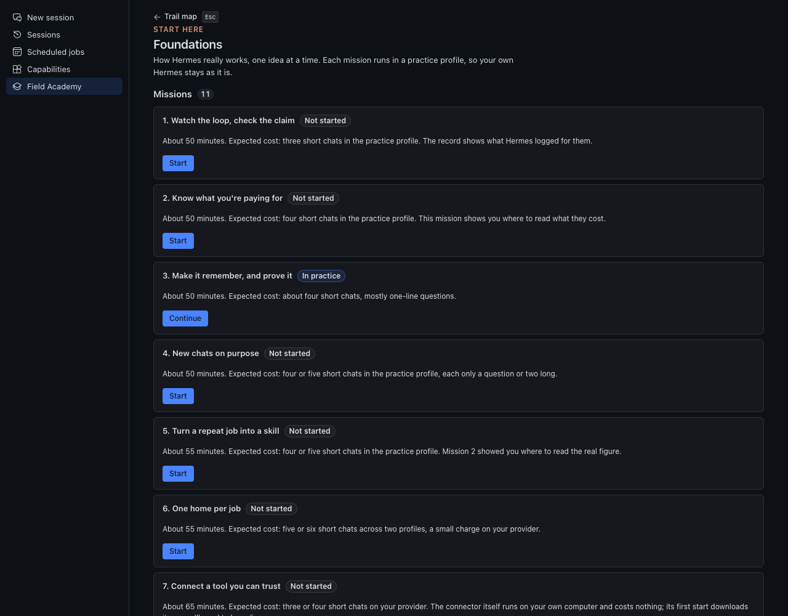
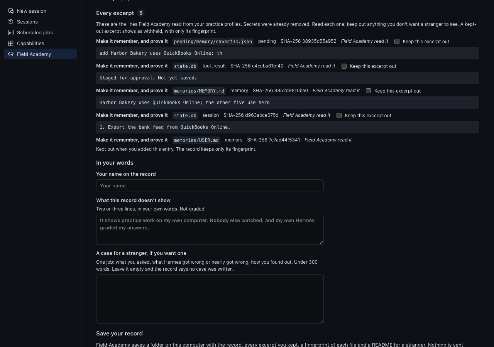

# Field Academy: the School of Hermes

A Hermes Desktop plugin that teaches Hermes Agent by having you use it. Get good at Hermes by using it, learn all of
what it can do, then learn to help other people use it. Every mission you pass goes into your Field Record with the
lines Field Academy read from Hermes as evidence. Free, MIT licensed, and everything stays on your computer.

The school is the trail map. Everyone starts at the Foundations trailhead. Five trails climb Mount Olympus, each named
for one of Hermes's old jobs and for whom it serves: Messenger (for introductions), Traveler (for yourself),
Crossroads (for clients), Boundary Keeper (for an organization) and Guide (for clients, in practice). Each trail climbs
its camps to a summit flag, the Field Record for that trail.

| Camp | What you can do there |
|---|---|
| Beginner | See what Hermes is doing |
| Intermediate | Fit it to the work |
| Advanced | Let it run without you |
| Capstone | Solve your own problem |
| Summit | Your Field Record |

Practice missions sit in the camps where they fit. They run the same way as Foundations: a practice profile, a planted
problem, and a check that reads Hermes itself.

| Mission | Trail and camp |
|---|---|
| Give Hermes only the tools a job needs | Crossroads, Intermediate |
| Hand work to helper agents, and check what each one did | Boundary Keeper, Intermediate |
| Set Hermes up for someone else | Guide, Build |
| Write a walkthrough someone can follow on their own | Guide, Verify |
| Judge someone's work from their Field Record | Guide, Verify |

Field Academy is a community plugin by Damon Gardenhire. Nous Research didn't make it and doesn't issue, review or
endorse it or the records it writes.



**[Read the manual](docs/MANUAL.md)** for every step, with screenshots. Reviewing it? Start with
[REVIEWER-GUIDE.md](REVIEWER-GUIDE.md), a ten-minute tour.

## What a mission does

A prompt can tell Hermes what to do. It can't tell you whether Hermes did it. Every Foundations mission does three
things a prompt can't:

1. **A problem is planted first.** Field Academy makes a practice profile for the mission and sets up one problem a
   real setup has, before your first chat. In the memory mission, saves are held for approval, so Hermes says
   "saved" when nothing was written yet.
2. **The check reads Hermes itself.** When you press **Check**, Field Academy opens the practice profile's files:
   `memories/MEMORY.md`, the `pending` folder where held saves wait, `config.yaml`, the chat records in `state.db`,
   `cron/jobs.json` and the run history, the logs. What you say about your work is never the check.
3. **The record opens anywhere.** Each pass goes into your Field Record with the exact line Field Academy read and
   its SHA-256 fingerprint. The record saves as a folder that anyone can check with one command, without Hermes.

| | |
|---|---|
|  |  |
|  |  |

## The eleven Foundations missions

They come first on the map. Each takes about an hour and runs a few short chats on your own model provider; each
mission says what it expects to cost before you start.

| # | Mission | What you can claim when you pass |
|---|---|---|
| 1 | Check whether Hermes really did what it says | You can tell from what Hermes actually did whether its "done" is true. |
| 2 | See what a chat costs, and cut it | You can see what makes a chat cost what it does, and cut the cost without breaking the job. |
| 3 | Save a fact to memory and check it stuck | You can get a fact into memory and prove it from the memory file and a brand-new chat. |
| 4 | Start a new chat at the right time | You can change how Hermes behaves and know exactly when the change takes hold. |
| 5 | Turn a repeat job into a skill | You can make a skill Hermes finds and uses on its own, and prove it from the skill and the chat. |
| 6 | Keep two jobs apart in two profiles | You can keep two jobs fully apart in two profiles, and prove it from each profile's own records. |
| 7 | Connect an outside tool safely | You can connect an outside tool with only the access a job needs, and prove it from its settings. |
| 8 | Set up a job that runs on a schedule | You can set up a scheduled job that runs right with nobody watching, and prove it from its run history. |
| 9 | Stop a mistake before it happens, or undo it | You can say whether a mistake would be stopped before it happens or undone after. |
| 10 | Find out why Hermes failed, and fix it | You can find why Hermes failed with its own logs and tools, fix it, and show the fix holds. |
| 11 | Foundations review | You can take a small job through a profile you didn't set up and find what is planted in it. |



## Inside a mission

A mission runs as twelve steps. You can always see where you are on the row of steps at the top.

1. **Recall.** Three minutes to write two things from memory, without looking back: from the last mission, or,
   in the first one, from your own life.
2. **Your claim.** The sentence you're about to prove, in the mission's words.
3. **Your guess.** Before you start, say which checks you expect to pass.
4. **Practice.** Field Academy makes the practice profile and sets up the problem. A short try shows you the idea.
5. **The idea.** How this part of Hermes really works, with the defaults as of the Hermes release it was checked
   against.
6. **Watch it done.** Someone works the same kind of job step by step: what they did, saw, noticed and ruled out.
7. **Your turn.** The real job, in the practice profile. **Open practice chat** opens a new chat there. Your own
   profile stays as it was.
8. **Score yourself.** Say how you think each check went, before you see it.
9. **Check.** Field Academy reads the practice profile and shows what it found for each check. One check is hidden
   until the end. You also explain the idea in your own words, and your own Hermes scores the answer.
10. **Compare.** Your guess, your own score and the real result, side by side.
11. **Fix and transfer.** Fix what missed, then use the idea on a second, different job.
12. **Record.** Add the mission to your Field Record.

## Practice profiles

A practice profile is an ordinary Hermes profile that Field Academy asks Hermes to make. It is named
`academy-practice` (a second one, for missions that need two, is `academy-practice-b`; a new try gets `-2`, `-3`
and so on). Field Academy only ever works in profiles with these names that it made and recorded itself.

Before the first chat in a practice profile, Field Academy may write a few named settings, the two memory files
and some sample files in the profile's practice folder. After the first chat, it only reads. When you finish, delete
the profile from the page, or in Hermes under **Settings**, **Profiles**.

## Your Field Record

At any point you can open your Field Record: the claims you proved, how your guesses compared with the checks, how
long you spent, and every excerpt Field Academy read, each with who checked it. You see every excerpt before you
save and can keep any of them out; a kept-out excerpt shows only its fingerprint.



**Save my Field Record** writes a folder on your computer:

```
field-records/foundations-<date>/
    record.md          the record, to read
    record.json        the record's data, exactly what the record number covers
    evidence/          each excerpt you kept, one file each
    MANIFEST.sha256    a fingerprint for every other file
    README.txt         how someone else checks the folder
```

Anyone you give the folder to can run `shasum -a 256 -c MANIFEST.sha256` inside it to see that every file matches
its fingerprint. That catches a file damaged or changed by accident. It doesn't show the folder is the one you
saved: whoever edits a file can also write a new manifest and a new record number. Send the record number by
another route (an email when you save it) and a reader can compare. It doesn't prove the work was done honestly
either; see [Honest limits](#honest-limits).

## The paths and the Guide path

After Foundations, four paths climb Beginner, Intermediate and Advanced, then end with a capstone on your own
problem: **Messenger** (explain Hermes and spot where it fits), **Traveler** (run it on your own computer),
**Crossroads** (connect it to a client's tools) and **Boundary Keeper** (who owns what, who approves what, how it
recovers). Twenty missions in all. A fifth path, **Guide**, is for people who set up and run Hermes for a client:
practice labs built from made-up data, a proposal, one real service run by a scheduled job for several days, a
recovery drill, and a review signed by a reviewer you choose. Passed missions come back for short spaced reviews.
The manual covers all of it.

## Install

You need Hermes Desktop with Hermes Agent 0.22.0 or newer. This release was checked against Hermes 0.23.0.

1. In Hermes Desktop, click **Capabilities**, then **Plugins**, find Field Academy and click **Install**. Or open
   [hermes://plugin/install?catalog=field-academy](hermes://plugin/install?catalog=field-academy).

   Prefer the terminal? On the computer where Hermes runs (PowerShell on Windows), type:

   ```bash
   hermes plugins install Dgardenhire/hermes-field-academy --enable
   ```

2. Restart Hermes, or press Cmd-K (Ctrl-K on Windows and Linux) and choose **Reload desktop plugins**.
3. Click **Field Academy** under **Tools** in the sidebar, then **Open Foundations**.

To remove it, run `hermes plugins remove field-academy`. Your progress stays in
`~/.hermes/plugin-data/field-academy/` until you delete that folder. Practice profiles stay until you delete them.

## Privacy: what Field Academy reads and writes

**In practice profiles only** (never your own profiles):

- **Makes and deletes them** through Hermes's own profile calls, when you press the button for it. Hermes itself
  copies your provider sign-in into a new profile so practice chats work; Field Academy never reads those files.
- **Writes, before the first chat only:** named settings in `config.yaml` (such as `memory.write_approval`, a
  connector entry or `terminal.cwd` set to the profile's own folder), `memories/MEMORY.md` and `memories/USER.md`,
  and sample files in the profile's practice folder. Never `.env`, `auth.json` or any other file.
- **Asks Hermes, through its gateway,** to make and pause the scheduled jobs a mission needs, to list the
  profile's chats and undo snapshots, and to open a new chat there. On a Hermes that offers them, it can start the
  practice profile's doctor and backup.
- **Reads:** the memory files and held saves, named keys from `config.yaml`, chat records and usage in `state.db`,
  `cron/jobs.json` and the run history, the logs, the skills folder and the undo snapshot folder. Excerpts are
  cleaned of anything that looks like a key before they are stored.

**In its own data folder** (`~/.hermes/plugin-data/field-academy/`): your progress database, pasted documents,
Guide labs and review packets, and the Field Records you save.

**Planted problems are real settings.** Missions 2 and 7 plant a filesystem connector that Hermes starts with
`npx` when a practice chat opens (it downloads a pinned package from npm and runs it, aimed at a folder inside the
practice profile). Mission 9 switches off an approval safeguard in the practice profile until you fix it, and the
terminal tool reaches your whole computer, so fix it before you give Hermes work. Practice jobs run hourly on your
provider once repaired. The details are in [docs/privacy.md](docs/privacy.md#what-the-planted-problems-do-while-they-stand).

**AI help:** the Field guide, Score my answer and the notes on the replay ask your own model through Hermes, on two
tasks Field Academy registers (`field_academy_guide`, `field_academy_grader`) that you can point at any model in
Settings, Models. What goes to the model: the mission's own text, your answers, and short scrubbed excerpts of the
practice profile's chats and files, never your own profiles. A model reply never sends, approves, deletes or writes
anything, and never decides a check. Turn it off with **Turn off AI help** at the foot of the Field guide; the checks work without it.

**Everywhere else:** Field Academy makes no network calls of its own (a source link opens in your browser only when you
click it; model calls go through Hermes, above), holds no credentials, sends no telemetry, runs no shell commands, starts no background processes and
never updates itself. The two hooks work as in
0.8: `pre_llm_call` may add one sentence offering a practice, in interactive sessions only, and `post_tool_call`
notes which tool was used. More in [SECURITY.md](SECURITY.md) and [docs/privacy.md](docs/privacy.md).

## What is verified, and what is not

Tested here, without a live Hermes: the full test suite (Python and Node), every screen through the harness in
light and dark, with a red and a green accent, wide and narrow, and every reader against fixture profiles built
from Hermes's own schema. Every "as of Hermes" fact in the lessons is matched against the Hermes 0.23.0 source at
its release tag (`scripts/check_foundations.py --hermes-ref v0.23.0`).

Not tested here:

- **A live run of every Foundations mission in Hermes Desktop.** The page was driven through a stand-in for the
  plugin SDK that serves the real backend. `docs/LIVE-TEST.md` is the checklist for a live run.
- **Learners.** Nobody outside the author has taken Foundations yet.

## Honest limits

- **A Field Record shows what passed on your own computer.** Someone who edits their own saved data can fake a
  pass. The fingerprints show the files match each other, not that they are the ones you saved or that the work
  was honest.
- **Your own Hermes scores your written answers**, so a score depends on your model.
- **Checks read files, not intentions.** A check can see that a fact is in `MEMORY.md` and that a new chat used it.
  It can't see why you did what you did; your written answers cover that.
- **Some things only the live app can confirm,** such as whether an approval prompt appeared. Those checks say so
  on screen and tell you how to look for yourself.
- **Lessons describe Hermes as of a release.** Each fact is labelled with the version it was checked against. A
  later Hermes can change a default before the lesson catches up.

## For developers

The page Hermes loads, `desktop/plugin.js`, is built from `desktop/src/` and the shared design kit (hermes-ui-kit,
a sibling folder): `node ../hermes-ui-kit/scripts/build.mjs .`. It imports only `@hermes/plugin-sdk`, `react` and
`react/jsx-runtime`.

```bash
python3 -m unittest discover -s tests              # Python suite (runs the Node tests too, if node is installed)
python3 scripts/check_foundations.py               # every mission against the teaching rules
HERMES_SOURCE=~/hermes-agent python3 scripts/check_foundations.py --hermes-ref v0.23.0
python3 harness/make_fixtures.py                   # the real backend, in a throwaway folder
python3 harness/shoot.py doc-home doc-lab          # screenshots, one headless Chrome at a time
```

Lessons live in `content/foundations/` (one Python file and four Markdown files a mission). The harness needs
network for its CDN imports and never runs a `hermes` command.

## Credits

The teaching draws on other people's work: the Nous Research Hermes docs, Tonbi's masterclass (linked through Kevin
Simback's Hermes Atlas), Kevin Simback's Hermes Atlas guides, iamlukethedev's Hermes Bible, and Tony Simons,
whose site tonysimons.dev is the reference for the shape of the Guide path. See [CREDITS.md](CREDITS.md).

## License

MIT. See [LICENSE](LICENSE).
