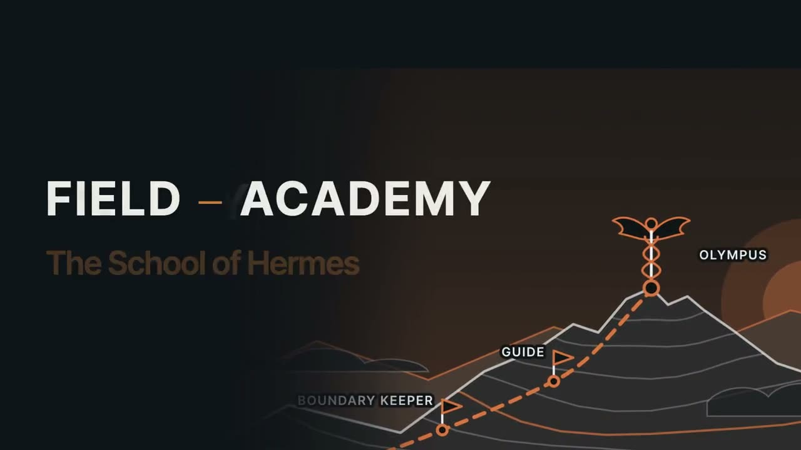

# Field Academy: the School of Hermes


[](https://linchpin.studio/hermes/video/field-academy.mp4)

**[Watch the 30-second demo](https://linchpin.studio/hermes/video/field-academy.mp4)** · [Manual](https://linchpin.studio/school-of-hermes/manual/) · [All four plugins](https://linchpin.studio/hermes/)

**New in 0.9:** Foundations, eleven new missions that teach how Hermes really works, each in a practice copy with one problem planted in it, and a trail map of the five trails.

Field Academy, The School of Hermes, teaches you Hermes Agent by having you use it. Start with 11 Foundations missions
in a throwaway copy of Hermes where one thing is quietly broken, and learn to check what Hermes actually wrote against
what it told you. Then take 34 missions across five trails in your own Hermes. It asks before it ever suggests a
mission in your chats.

Every Foundations mission works the same way. Field Academy makes a practice profile, a separate Hermes setup, and
plants one problem in it, the kind a real setup has. You do a job there and say how you think it went. Then Field
Academy opens Hermes's own files and chat records and shows what happened. The gap between your guess and the files is
the lesson.

| | |
|---|---|
| Version | 0.9.0 |
| Needs | Hermes Desktop with Hermes Agent 0.22.0 or newer. Each lesson names the Hermes version it was checked against (0.23.0). |
| Cost | Free, MIT license. Practice chats run on your own model provider; each mission says how many chats to expect. |
| Made by | Damon Gardenhire. An independent plugin, not an official Nous Research plugin. |


## Install

You need a model already set up in Hermes. If you've chatted with Hermes, you already have one; if not, set one up in
Hermes under Settings, Models. Install once, on the computer where Hermes runs. Field Academy is in the Hermes plugin
catalog.

1. In Hermes Desktop, click **Capabilities**, then **Plugins**, find Field Academy and click **Install**. Or open
   [hermes://plugin/install?catalog=field-academy](hermes://plugin/install?catalog=field-academy).

   Prefer the terminal? Type this instead (PowerShell on Windows):

   ```bash
   hermes plugins install field-academy --enable
   ```

2. Restart Hermes, or press Cmd-K (Ctrl-K on Windows and Linux) and choose **Reload desktop plugins**.
3. Click **Field Academy** in the sidebar.

**[Read the manual](https://linchpin.studio/school-of-hermes/manual/)** for every step, with screenshots.

## Uninstall

Do these in order, so nothing keeps running on your model provider:

1. **Pause or delete practice jobs.** In Hermes, open **Scheduled jobs**, switch to each `academy-practice` profile, and
   pause or delete its jobs. A repaired practice job runs every hour until you do. Deleting the profile (next step)
   removes its jobs too.
2. **Delete the practice profiles.** On a mission's practice panel, press **Delete practice profiles**, or in Hermes open
   Settings, Profiles and delete each `academy-practice` profile (`academy-practice-b` and numbered ones too).
3. **Delete your data, if you want it gone.** Open Field Academy's **Your data** (at the foot of its home page, or
   Settings, Plugins, Field Academy) and press **Delete my progress** to keep your saved Field Records, or **Delete
   everything** to remove them too. If the plugin is already removed, delete `~/.hermes/plugin-data/field-academy/`
   (inside `$HERMES_HOME` if you moved it) by hand. Field Records you saved somewhere else stay where you put them.
4. **Remove the plugin.** In Hermes, open **Capabilities**, then **Plugins**, and remove Field Academy. Or run
   `hermes plugins remove field-academy`.

The trail missions are done in your own Hermes. Their lab chats open in your own session list, and the documents you
write stay where you saved them. The Traveler trail also leaves a fact saved to memory, a skill whose name starts with
`academy-`, and a scheduled job whose name starts with `academy-`. To remove them, delete the chats in Hermes's session
list, ask Hermes to forget the fact, delete the `academy-` skill under Skills, and pause or delete the `academy-` job
under **Scheduled jobs**.

## What a mission does

A prompt can tell Hermes what to do. It can't tell you whether Hermes did it. Every mission does three things a prompt
can't.

1. **A problem is planted first.** In the memory mission, for example, saves are held for approval, so Hermes says
   "saved" when nothing was written yet.
2. **The check reads Hermes itself.** When you press **Check my work**, Field Academy opens the practice profile's own
   files: the memory files, `config.yaml`, the chat records, the scheduled jobs and their run history, and the logs.
   What you say about your work is never the check.
3. **The record opens anywhere.** Each pass goes into your Field Record with the exact line Field Academy read and a
   fingerprint of it. Anyone can check the saved record with one command, without Hermes.

You guess before you start, score yourself before you see the result, and then see both next to what Hermes did.
Compare puts your chat and Hermes's files on one time line, and an amber bracket joins the chat line that looked fine to
the file that shows otherwise.


## The trail map

The home page is a map of Mount Olympus. Everyone starts at the Foundations trailhead. Five trails climb from there,
each named for one of Hermes's old jobs and for whom it serves.

| Trail | For | Missions |
|---|---|---|
| Messenger | introductions | 5 |
| Traveler | yourself | 5 |
| Crossroads | clients | 5, plus 1 practice mission |
| Boundary Keeper | an organization | 5, plus 1 practice mission |
| Guide | clients, in practice | 9 parts, plus 3 teaching missions |

The practice and teaching missions are extras: a trail's count, like 0 of 5, covers only what its Field Record needs.

The map's columns are camps. Messenger, Traveler, Crossroads and Boundary Keeper climb all four, then reach a summit
flag, the Field Record for that trail.

| Camp | What you can do there |
|---|---|
| Beginner | See what Hermes is doing |
| Intermediate | Fit it to the work |
| Advanced | Let it run without you |
| Capstone | Solve your own problem |
| Summit | Your Field Record |

A trail mission has six steps: the story, the takeaway, your turn (fill in a half-done example), try it, explain it
(your own Hermes scores it out of 100, and 70 passes) and prove it (make something real, then press **Check my
work**). Each of the four trails has a placement check of six questions, two per level. Get both questions on a level
right and you can skip that level's reading. Every mission's check still applies.


### Practice missions on the trails

Five missions run the Foundations way, in a practice profile with a planted problem and a check that reads Hermes.

| Mission | Trail and camp | About |
|---|---|---|
| Give Hermes only the tools a job needs | Crossroads, Intermediate | 55 minutes |
| Hand work to helper agents, and check what each one did | Boundary Keeper, Intermediate | 60 minutes |
| Set Hermes up for someone else | Guide, Build | 55 minutes |
| Write a walkthrough someone can follow on their own | Guide, Verify | 50 minutes |
| Judge someone's work from their Field Record | Guide, Verify | 50 minutes |

Each helper agent is a short chat of its own, so the helper-agents mission uses more of your model than its two or
three chats suggest.

### The Guide trail

Can you set up and run Hermes for a small client? Guide has four camps and nine parts:

- **Audit:** three labs of made-up data, each with a problem hidden in it: *The key in the open*, *The runaway bill*
  and *Monday after the power cut*.
- **Architect:** a fourth lab, *One key for everything*; *A proposal for a three-person firm*; and *Nine judgment
  scenarios*, hard cases with no clean answer.
- **Build and integrate:** *Run one real service for several days*, with the smallest permission that does the job,
  for at least three days. Plus the Teach mission *Set Hermes up for someone else*.
- **Staged verification:** *Failure drills*, where you break something and show Hermes recovers; *Walkthrough and
  expert review*; and the other two Teach missions.

To finish the trail, a reviewer you choose, someone with the experience to judge your work, reads your packet and
signs it with their own key. You paste their signed file into the page. Until then the trail reads *Guide, awaiting
review*.


## The eleven Foundations missions

They sit beside Start here on the home page. Each is planned as 50 to 75 minutes of work and a few short chats on your
own model provider. Mission 8 also waits for scheduled runs, up to about three hours.

| # | Mission | You can claim when you pass | Minutes |
|---|---|---|---|
| 1 | Check whether Hermes really did what it says | You can tell, from what Hermes actually did, whether its "done" is true. | 50 |
| 2 | See what a chat costs, and cut it | You can see what makes a chat cost what it does, and cut the cost without breaking the job. | 50 |
| 3 | Save a fact to memory and check it stuck | You can get one fact into memory and prove it from the memory file and a brand-new chat. | 50 |
| 4 | Start a new chat at the right time | You can change how Hermes behaves and know exactly when the change takes effect. | 50 |
| 5 | Turn a repeat job into a skill | You can turn a job you repeat into a skill Hermes finds and uses on its own, and prove it from the skill file and a new chat. | 55 |
| 6 | Keep two jobs apart in two profiles | You can keep two jobs fully separate and prove from each profile's own records that nothing crosses between them. | 55 |
| 7 | Connect an outside tool safely | You can connect a tool with only the access a job needs, and prove it from its settings and a real attempt. | 65 |
| 8 | Set up a job that runs on a schedule | You can set up a scheduled job that runs right with nobody watching, and prove from Hermes's records that it ran on time and delivered. | 75 |
| 9 | Stop a mistake before it happens, or undo it | You can say whether a mistake would be caught before it happens or undone after, and close every gap that can be closed. | 60 |
| 10 | Find out why Hermes failed, and fix it | You can find why Hermes failed with its own diagnostics, fix it, and show the fix holds. | 70 |
| 11 | Foundations review | You can take a small job through a profile you didn't set up, find what is planted in it, and account for every claim, model and change. | 75 |

Already use Hermes? On the Foundations page, **Test out** skips the Recall step and turns the Field guide off. Pass every
check on the first run, your written explanation included, and the mission goes on your record as *Tested out*. Miss
one and you finish it the usual way. Mission 11 is the review itself, so it has no test-out.

## Inside a mission

A mission runs as twelve steps in four groups. A group stays locked until the one before it is done.

1. **Get ready:** Recall (write two things from memory), Your claim, Your guess (which checks you expect to pass, and
   how sure you are), and Practice (Field Academy makes the practice profile and sets up the problem).
2. **Learn:** The idea, and Watch it done. Both are optional.
3. **Do:** Your turn, the real job in the practice profile, then Did it work?, where you score yourself.
4. **See what happened:** Check, Compare, Fix it and Record.

**Open practice chat** opens a new chat in the practice profile every time, since some missions are about what a new
chat knows. Your own profile stays as it was.

In missions 1 to 10, one check stays hidden so you can't aim at it, and the check won't run until you've scored
yourself. After a miss, **Fix it** has you repair the practice profile and press **Check my fix**, then do the job once
more a little differently and press **Check the transfer**.


### The Field guide

The Field guide is the column on the right of a mission. It runs on your own model and coaches you toward the problem
without handing it over: **Give me a hint**, **Show me where to look**, **Why did this miss?**, **Point out the key
moments** in the replay, **Ask**, and **Score my answer**, where you explain the mission in your own words and your
model gives it a level from 1 to 4. Level 3 passes. Only the checks decide whether a check passed. Each help you use
goes on your record.

**Turn off AI help** at the foot of the column, or the **AI help** switch in Field Academy's Settings, stops every model
call Field Academy makes. Every check still works, and **Score it in a chat instead** opens a grading chat in your own
profile.

### Reviews

Passed trail missions come back for a short review: three questions, about six minutes, scored by your own Hermes. The
first comes two days after you pass, then 7, 21 and 60 days if you answer well. A poor answer brings it back the next
day, and the mission stays passed. Each shows **Strong**, **Holding**, **Fading** or **Weak**.

## Your Field Record

Your Field Record is your own record of what you proved. It lists your claims and the checks behind them, your guess,
score and the real result for each, every excerpt Field Academy read with its file and fingerprint, your time, notes in
your own words, and how far you got on each trail. You see every excerpt before you save and can keep any of them out.
Every record says it is self-issued and not issued or endorsed by Nous Research.


**Save my Field Record** writes a folder on your computer:

```
field-records/foundations-<date>/
    record.md          the record, to read
    record.json        the record's data, exactly what the record number covers
    evidence/          each excerpt you kept, one file each
    MANIFEST.sha256    a fingerprint for every other file
    README.txt         how someone else checks the folder
```

Anyone you give the folder to can run `shasum -a 256 -c MANIFEST.sha256` inside it (`sha256sum -c` on Linux,
`Get-FileHash -Algorithm SHA256` on Windows) to see that every file matches its fingerprint. To let a reader confirm
the folder is the one you saved, send the record number by another route, such as an email when you save it.

## Privacy

Field Academy makes no network calls of its own, holds no keys or passwords, sends no usage data and never updates
itself. Its own code runs no other programs.

- **Practice profiles only.** Field Academy makes, changes and deletes only the `academy-practice` profiles it made
  itself, never your own profiles. Before a practice profile's first chat, it writes the settings, memory files and
  sample files a mission plants. It never changes Hermes's approval rules (`approvals.*` or the always-allow list) and never writes sign-in files.
- **What it reads.** In a practice profile: memory, settings, skills, chat records, scheduled jobs and logs, read only.
  Anything that looks like a key is removed from an excerpt before it is stored. On the Guide trail it also reads, read
  only, the run history and logs for the one job you name in your own Hermes, and documents you name.
- **What Hermes runs for a mission.** Some missions add a filesystem connector to the practice profile. Hermes then
  downloads a pinned package, `@modelcontextprotocol/server-filesystem@2026.8.31`, from npm and runs it. Field Academy
  never aims a connector at a folder that holds your sign-in files. A repaired practice job runs every hour on your
  model provider until you pause or delete it.
- **AI help.** The Field guide, Score my answer and the replay notes send the mission's text, your answers and short
  cleaned excerpts of the practice profile to the model you set up in Hermes, never your own profiles' chats, your keys
  or your Field Record. **Score it in a chat instead**, **Send for scoring** and reviews send your answer in a new chat
  in your own profile. **Turn off AI help** stops all of it.
- **Mission suggestions.** Field Academy asks first. Until you say yes to **Want mission suggestions while you chat?**,
  it adds nothing to your chats. The switch is also under Settings.
- **Its own data** stays in `~/.hermes/plugin-data/field-academy/` (`%LOCALAPPDATA%\hermes\plugin-data\field-academy`
  on Windows): your progress, answers, pasted documents, Guide labs and packets, and the Field Records you save.

Full detail: [docs/privacy.md](docs/privacy.md) and [SECURITY.md](SECURITY.md).

## What is verified

Every Hermes fact in the lessons is labeled with the Hermes version it was checked against. Field Academy is new: so
far only its author has walked it live in Hermes.

## Honest limits

- **A Field Record shows what passed on your own computer.** Someone who edits their own saved data can fake a pass.
  The fingerprints show the files match each other, not that the work was honest.
- **Your own Hermes scores your written answers,** so a score depends on your model. The Guide trail's signature shows
  your reviewer signed your packet, not that anyone else vouches for them.
- **Checks read files, not intentions.** A check can see that a fact is in `MEMORY.md` and that a new chat used it. It
  can't see why you did what you did; your written answers cover that.
- **Some things only the live app can confirm,** such as whether an approval prompt appeared. Those checks say so on
  screen and tell you how to look for yourself.
- **Lessons describe Hermes as of a release.** A later Hermes can change a default before the lesson catches up.

## For developers

Reviewing it? Start with [REVIEWER-GUIDE.md](REVIEWER-GUIDE.md), a ten-minute tour. The page Hermes loads,
`desktop/plugin.js`, is built from `desktop/src/` with the shared design kit (hermes-ui-kit, a sibling folder):
`node ../hermes-ui-kit/scripts/build.mjs .`.

```bash
python3 -m unittest discover -s tests              # Python suite (runs the Node tests too, if node is installed)
python3 scripts/check_foundations.py               # every mission against the teaching rules
HERMES_SOURCE=~/hermes-agent python3 scripts/check_foundations.py --hermes-ref v0.23.0
```

It registers six tools, two hooks (`post_tool_call` notes which tool you used, on your computer;
`pre_llm_call` adds a mission suggestion only if you said yes), the `/academy` command and one skill. Lessons live in
`content/foundations/`.

## Credits

The teaching draws on other people's work: the Nous Research Hermes docs, Tonbi's masterclass (linked through Kevin
Simback's Hermes Atlas), Kevin Simback's Hermes Atlas guides, iamlukethedev's Hermes Bible, and Tony Simons, whose site
tonysimons.dev is the reference for the shape of the Guide trail. See [CREDITS.md](CREDITS.md).

## License

MIT. See [LICENSE](LICENSE).
