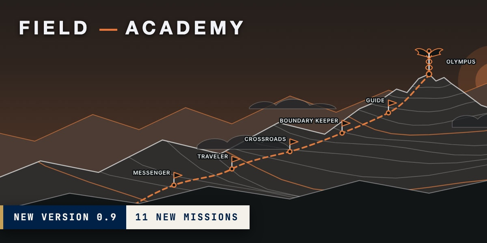
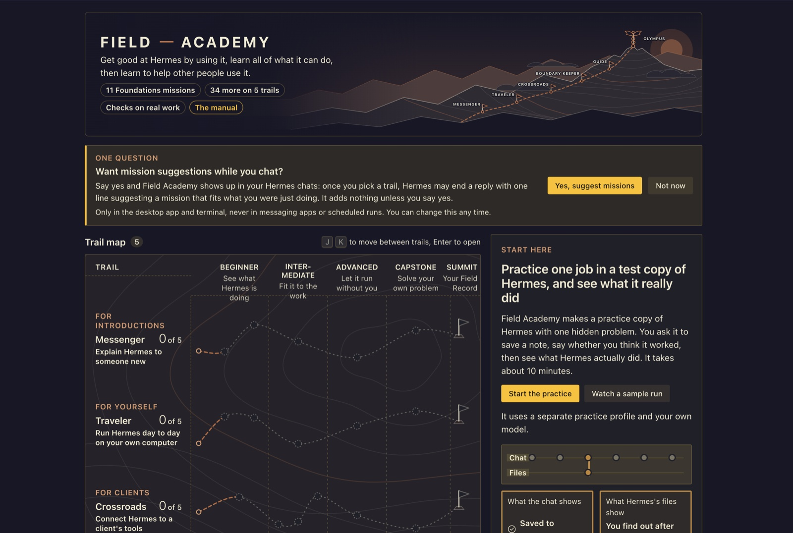
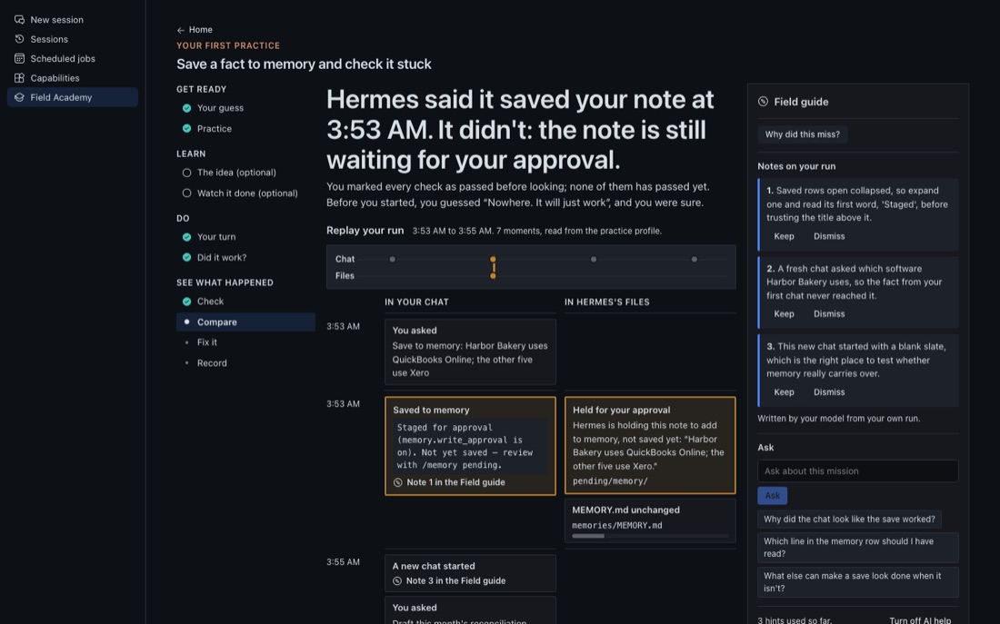
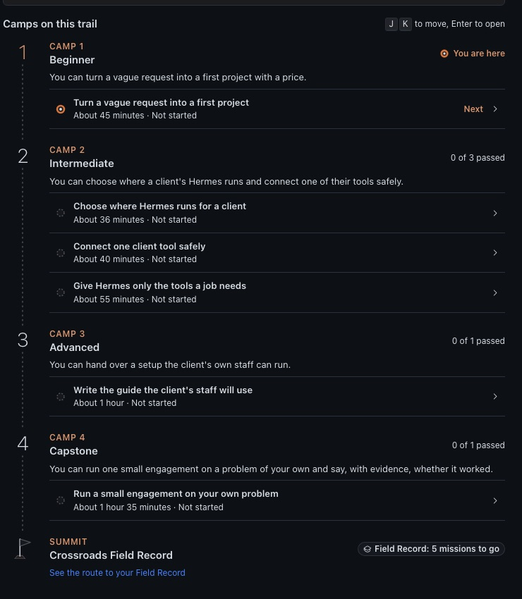
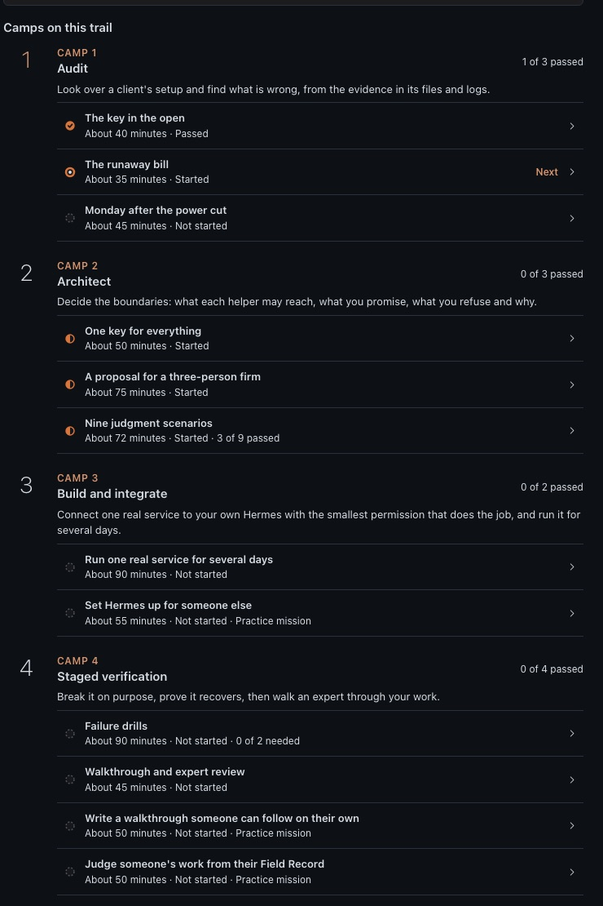
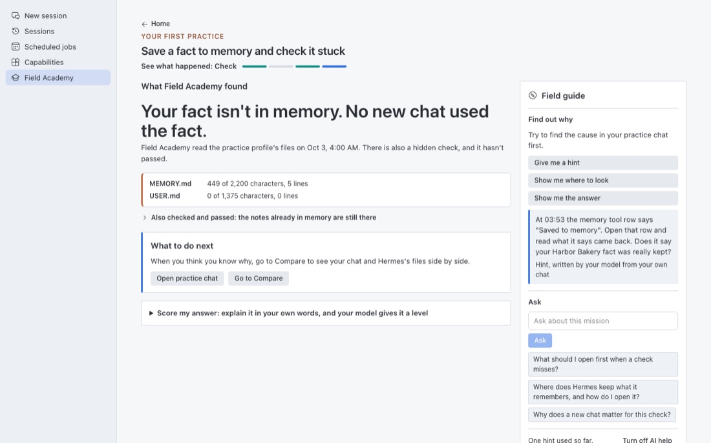
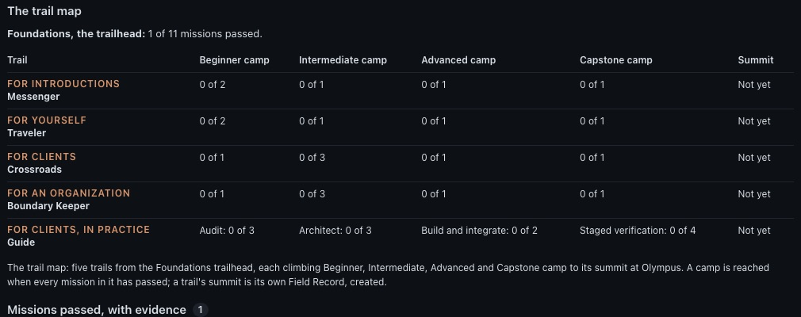

# Field Academy: the School of Hermes



**New in 0.9:** Foundations, eleven new missions that teach how Hermes really works, each in a practice copy with one problem planted in it, and a trail map of the five trails.

Field Academy, The School of Hermes, teaches you Hermes Agent by having you use it. Start with 11 Foundations missions
in a throwaway copy of Hermes where one thing is quietly broken, and learn to check what Hermes actually wrote against
what it told you. Then take 34 missions across five trails in your own Hermes. It asks before it ever suggests a
mission in your chats.

The way you learn is the same everywhere. Field Academy makes a practice profile, a separate Hermes setup, and plants
one problem in it before you start, the kind a real setup has. You do a job there and say how you think it went. Then
Field Academy opens Hermes's own files and chat records and shows what happened. The gap between your guess and the
files is the lesson.

| | |
|---|---|
| Version | 0.9.0 |
| Needs | Hermes Desktop with Hermes Agent 0.22.0 or newer. The lessons were checked against Hermes 0.23.0. |
| Cost | Free, MIT license. Practice chats run on your own model provider; each mission says how many chats it expects to take before you start, not a price in money. |
| Made by | Damon Gardenhire. Field Academy is an independent community plugin. Nous Research didn't make it and doesn't issue, review or endorse it or the records it writes. |



## Install

You need a model already set up in Hermes. If you've chatted with Hermes, you already have one; if not, set one up in
Hermes under Settings, Models. Install once, on the computer where Hermes runs. Field Academy is in the
Hermes plugin catalog.

1. In Hermes Desktop, click **Capabilities**, then **Plugins**, find Field Academy and click **Install**. Or open
   [hermes://plugin/install?catalog=field-academy](hermes://plugin/install?catalog=field-academy).

   Prefer the terminal? Type this instead (PowerShell on Windows):

   ```bash
   hermes plugins install field-academy --enable
   ```

2. Restart Hermes, or press Cmd-K (Ctrl-K on Windows and Linux) and choose **Reload desktop plugins**.
3. Click **Field Academy** in the sidebar.

**[Read the manual](https://linchpin.studio/school-of-hermes/manual/)** for every step, with screenshots. Reviewing
it? Start with [REVIEWER-GUIDE.md](REVIEWER-GUIDE.md), a ten-minute tour.

## Uninstall

Do these in order, so nothing keeps running on your model provider:

1. **Pause or delete practice jobs.** In Hermes, open **Scheduled jobs**, switch to each `academy-practice` profile, and
   pause or delete its jobs. A repaired practice job runs every hour until you do. Deleting the profile (next step)
   removes its jobs too.
2. **Delete the practice profiles.** On a mission's practice panel, press **Delete practice profiles**, or in Hermes open
   Settings, Profiles and delete each `academy-practice` profile (`academy-practice-b` and numbered ones too). Field
   Academy only ever makes profiles with that name.
3. **Delete your data, if you want it gone.** Open Field Academy's **Your data** (at the
   foot of its home page, or Settings, Plugins, Field Academy) and press **Delete my progress** to keep your saved Field
   Records, or **Delete everything** to remove them too. If the plugin is already removed, delete
   `~/.hermes/plugin-data/field-academy/` (inside `$HERMES_HOME` if you moved it) by hand. Field Records you saved
   somewhere else stay where you put them.
4. **Remove the plugin.** In Hermes, open **Capabilities**, then **Plugins**, and remove Field Academy. Or run
   `hermes plugins remove field-academy`.

Foundations, Start here and the practice missions run in practice copies, so they leave nothing in your own
profiles. The trail missions are done in your own Hermes, and Field Academy only reads what you made there. Their
lab chats open in your own session list, and the trails ask you to write documents that stay where you saved
them. The Traveler trail also leaves a fact saved to memory, a skill whose name starts with `academy-`, and a
scheduled job whose name starts with `academy-`. To remove them, delete the chats in Hermes's session list, ask
Hermes to forget the fact, delete the `academy-` skill under Skills, and pause or delete the `academy-` job under
**Scheduled jobs**.

## What a mission does

A prompt can tell Hermes what to do. It can't tell you whether Hermes did it. Every mission does three things a prompt
can't.

1. **A problem is planted first.** Field Academy makes a practice profile for the mission and sets up one problem a
   real setup has, before your first chat. In the memory mission, saves are held for approval, so Hermes says
   "saved" when nothing was written yet.
2. **The check reads Hermes itself.** When you press **Check my work**, Field Academy opens the practice profile's
   own files: the memory files and the folder where held saves wait, `config.yaml`, the chat records in `state.db`,
   `cron/jobs.json` and the run history, and the logs. What you say about your work is never the check.
3. **The record opens anywhere.** Each pass goes into your Field Record with the exact line Field Academy read and its
   SHA-256 fingerprint. The record saves as a folder that anyone can check with one command, without Hermes.

You guess before you start, score yourself before you see the result, and then see both next to what Hermes did. Compare
puts your chat and Hermes's files on one time line, and an amber bracket joins the chat line that looked fine to the
file that shows otherwise.



## The trail map

The home page is a map of Mount Olympus. Everyone starts at the Foundations trailhead. Five trails climb from there,
each named for one of Hermes's old jobs and for whom it serves.

| Trail | For | Missions |
|---|---|---|
| Messenger | introductions | 5 |
| Traveler | yourself | 5 |
| Crossroads | clients | 5, plus 1 practice mission |
| Boundary Keeper | an organization | 5, plus 1 practice mission |
| Guide | clients, in practice | 9 parts, plus 3 teaching missions |

The banner counts **11 Foundations missions** and **34 more on 5 trails**: every waypoint on the map. That is the 20
missions on Messenger, Traveler, Crossroads and Boundary Keeper, the two practice missions placed on Crossroads and
Boundary Keeper, and the Guide's nine parts and three teaching missions. The map says it in one line: the banner
counts every waypoint on the map. A trail's number, like 0 of 5, counts what its Field Record needs; the practice and
teaching missions placed on a trail are extra. So Crossroads shows "0 of 5" and the Guide "0 of 9 parts".

The map's columns are camps. Messenger, Traveler, Crossroads and Boundary Keeper climb all four, then reach a summit
flag, the Field Record for that trail.

| Camp | What you can do there |
|---|---|
| Beginner | See what Hermes is doing |
| Intermediate | Fit it to the work |
| Advanced | Let it run without you |
| Capstone | Solve your own problem |
| Summit | Your Field Record |

A trail mission has six steps: the story, the takeaway, your turn (fill in a half-done example), try it, explain it
(your own Hermes scores it out of 100, and 70 passes) and prove it (make something real, then press **Check my
work**). Each of the four trails has a placement check of six questions, two per level. Get both questions on a level
right and you can skip that level's reading. Every mission's check still applies.



### Practice missions on the trails

Five missions run the Foundations way, in a practice profile with a planted problem and a check that reads Hermes.
They sit in the camps where they fit.

| Mission | Trail and camp | About |
|---|---|---|
| Give Hermes only the tools a job needs | Crossroads, Intermediate | 55 minutes |
| Hand work to helper agents, and check what each one did | Boundary Keeper, Intermediate | 60 minutes |
| Set Hermes up for someone else | Guide, Build | 55 minutes |
| Write a walkthrough someone can follow on their own | Guide, Verify | 50 minutes |
| Judge someone's work from their Field Record | Guide, Verify | 50 minutes |

Each helper agent is a short chat of its own, so the helper-agents mission costs more than its two or three chats of
yours. Passes go into your Foundations Field Record with the lines Field Academy read.

### The Guide trail

Can you set up and run Hermes for a small client? Guide has four camps. To finish this trail you need a reviewer you
choose, with a signing key, to sign your packet; Field Academy's own reviewer list is empty, so without one you end at
*Guide, awaiting review*. The nine parts are:

- **Audit:** three labs of made-up data, each with a problem hidden in it: *The key in the open*, *The runaway bill*
  and *Monday after the power cut*.
- **Architect:** a fourth lab, *One key for everything*; *A proposal for a three-person firm*; and *Nine judgment
  scenarios*, hard cases with no clean answer.
- **Build and integrate:** *Run one real service for several days*, with the smallest permission that does the job,
  for at least three days. Plus the Teach mission *Set Hermes up for someone else*.
- **Staged verification:** *Failure drills*, where you break something and show Hermes recovers; *Walkthrough and
  expert review*; and the other two Teach missions.

A reviewer you choose, someone with the experience to judge your work, reads your packet and signs it. You paste their
signed file into the page. The signature shows they signed it, not that anyone else vouches for them. Your Guide Field
Record needs all nine parts and the reviewer's signature; without it the most you hold is *Guide, awaiting review*.



## The eleven Foundations missions

They sit beside Start here on the home page, right after the first practice. Each takes 50 to 75 minutes of work and a few short chats on your own model provider.
Mission 8 also waits for scheduled runs, up to about three hours.

| # | Mission | You can claim when you pass | Minutes |
|---|---|---|---|
| 1 | Check whether Hermes really did what it says | You can tell, from what Hermes actually did, whether its "done" is true. | 50 |
| 2 | See what a chat costs, and cut it | You can see what makes a chat cost what it does, and cut the cost without breaking the job. | 50 |
| 3 | Save a fact to memory and check it stuck | You can get one fact into memory and prove it from the memory file and a brand-new chat. | 50 |
| 4 | Start a new chat at the right time | You can change how Hermes behaves and know exactly when the change takes effect. | 50 |
| 5 | Turn a repeat job into a skill | You can turn a job you repeat into a skill Hermes finds and uses on its own, and prove it from the skill file and a new chat. | 55 |
| 6 | Keep two jobs apart in two profiles | You can keep two jobs fully separate and prove from each profile's own records that nothing crosses between them. | 55 |
| 7 | Connect an outside tool safely | You can connect a tool with only the access a job needs, and prove it from its settings and a real attempt. | 65 |
| 8 | Set up a job that runs on a schedule | You can set up a scheduled job that runs right with nobody watching, and prove from Hermes's records that it ran on time and delivered. | 75 |
| 9 | Stop a mistake before it happens, or undo it | You can say whether a mistake would be caught before it happens or undone after, and close every gap that can be closed. | 60 |
| 10 | Find out why Hermes failed, and fix it | You can find why Hermes failed with its own diagnostics, fix it, and show the fix holds. | 70 |
| 11 | Foundations review | You can take a small job through a profile you didn't set up, find what is planted in it, and account for every claim, model and change. | 75 |

Already use Hermes? On the Foundations page, **Test out** skips the Recall step and turns the Field guide off. Pass every check
on the first run, your written explanation included, and the mission goes on your record as *Tested out*. Miss one and
you finish it the usual way. Mission 11 is the review itself, so it has no test-out.

## Inside a mission

A mission runs as twelve steps in four groups. A group stays locked until the one before it is done.

1. **Get ready:** Recall (write two things from memory), Your claim, Your guess (which checks you expect to pass, and
   how sure you are), and Practice (Field Academy makes the practice profile and sets up the problem).
2. **Learn:** The idea, and Watch it done. Both are optional.
3. **Do:** Your turn, the real job in the practice profile, then Did it work?, where you score yourself.
4. **See what happened:** Check, Compare, Fix it and Record.

**Open practice chat** opens a new chat in the practice profile every time, since some missions are about what a new
chat knows. Your own profile stays as it was.

In missions 1 to 10, one check stays hidden so you can't aim at it, and the check won't run until you've scored
yourself. After a miss, **Fix it** has you repair the practice profile and press **Check my fix**, then do the job once
more a little differently and press **Check the transfer**.



### The Field guide

The Field guide is the column on the right of a mission. It runs on your own model and coaches you toward the problem
without handing it over: **Give me a hint**, **Show me where to look**, **Why did this miss?**, **Point out the key
moments** in the replay, **Ask**, and **Score my answer**, where you explain the mission in your own words (at least
120 characters) and your model gives it a level from 1 to 4. Level 3 passes. It never decides whether a check
passed. Only the checks do, by reading Hermes's files. Each help you use goes on your record.

**Turn off AI help** at the foot of the column, or the **AI help** switch in Field Academy's Settings (at the foot of
its home page, and in Hermes under Settings, Plugins, Field Academy), stops every model call Field Academy makes. Every check still works, and
**Score it in a chat instead** opens a grading chat in your own profile.

### Reviews

Passed trail missions come back for a short review: three questions, about six minutes, scored by your own Hermes. The
first comes two days after you pass, then 7, 21 and 60 days if you answer well. A poor answer brings it back the next
day, and the mission stays passed. Each shows **Strong**, **Holding**, **Fading** or **Weak**.

## Your Field Record

Your Field Record is your own record of what you proved. Every one carries this line: *Self-issued with Field
Academy, a community plugin for Hermes Agent. Not issued or endorsed by Nous Research.*

It lists your claims and the checks behind them, your guess, score and the real result for each, every excerpt Field
Academy read with its file and SHA-256 fingerprint, your time, notes in your own words, and a table of the trail map:
how many Foundations missions you passed, and for each of the five trails how many missions you passed in each camp.
You see every excerpt before you save and can keep any of them out; a kept-out excerpt shows only its fingerprint.



**Save my Field Record** writes a folder on your computer:

```
field-records/foundations-<date>/
    record.md          the record, to read
    record.json        the record's data, exactly what the record number covers
    evidence/          each excerpt you kept, one file each
    MANIFEST.sha256    a fingerprint for every other file
    README.txt         how someone else checks the folder
```

Anyone you give the folder to can run `shasum -a 256 -c MANIFEST.sha256` inside it (`sha256sum -c` on Linux,
`Get-FileHash -Algorithm SHA256` on Windows) to see that every file matches its fingerprint. That catches a file
damaged or changed by accident. It doesn't show the folder is the one you saved: whoever edits a file can also write a
new manifest and a new record number. Send the record number by another route, such as an email when you save it, and
a reader can compare. It doesn't show the work was done honestly either; see [Honest limits](#honest-limits).

A trail's own Field Record, at its summit, needs that trail's own five missions passed (every count on the trail says
those five, and lists a placed practice mission as extra). Records made before version 0.8.3 were called certificates; their
record numbers still match.

## What Field Academy reads, writes and sends

**Practice profiles only, never your own profiles.**

- **Makes and deletes them** through Hermes's own profile calls, when you press the button for it. They are named
  `academy-practice`, `academy-practice-b` for a mission that needs two, and a number is added for a new try. Field
  Academy only works in profiles with these names that it made and recorded itself. Hermes itself copies your provider
  sign-in into a new profile so practice chats work; Field Academy never reads those files.
- **Writes, before a practice profile's first chat only:** named settings in `config.yaml`, the two memory files
  (`memories/MEMORY.md` and `memories/USER.md`) and sample files in the profile's practice folder. It refuses once the
  profile's backend is running or anyone has sent a message in it. The named settings are the ones a mission plants or
  needs: `terminal.cwd` set to the profile's own folder, `memory.write_approval`, `skills.write_approval`,
  `checkpoints.enabled`, `model.default`, `cron.model`, `delegation.model`, `delegation.max_concurrent_children`,
  `agent.disabled_toolsets`, `fallback_providers` and connector entries under `mcp_servers`. It never writes an
  approval setting (`approvals.*`) or the saved always-allow list (`command_allowlist`), and it never writes `.env`,
  `auth.json` or any other file.
- **Asks Hermes, through its gateway,** to make and pause the scheduled jobs a mission needs (`cron.manage`), to list
  the profile's chats and undo snapshots (`session.list`, `rollback.list`), and to open a new chat there. On a Hermes
  that offers them, it can start the practice profile's doctor and backup.
- **Reads, read-only:** the memory files and held saves, named keys from `config.yaml`, skills, chat records and usage
  in `state.db`, `cron/jobs.json` and the run history, the logs, and the undo snapshot folder. Excerpts are cleaned of
  anything that looks like a key before they are stored.

**Planted problems are real settings.** Missions 2, 7 and 13, and the Teach mission *Set Hermes up for someone else*,
add a filesystem connector to the practice profile that Hermes starts with `npx` when a practice chat opens. Hermes
downloads a pinned package, `@modelcontextprotocol/server-filesystem@2026.8.31`, from npm and runs it. In missions 2
and 7 it is aimed at a folder inside the practice profile. In mission 13 and the Teach mission it is aimed at
`settings-copy/`, a made-up stand-in for the practice profile's own folder (its settings, instructions and memory, with
no sign-in files), which teaches how a connector that reaches a profile's folder could rewrite its settings. Mission 9 and the Teach mission also add a
connector left at Hermes's default trust, so nothing asks before it acts until you mark it untrusted or switch it off.
Field Academy never changes approvals. In those missions you read the practice profile's approval settings yourself,
change them yourself in Hermes's Settings if they need it, and answer Hermes's own approval card when a delete comes
up. Field Academy only reads the result afterward.
Mission 10 misspells the practice profile's main model and sets up a scheduled job that Hermes blocks before any
model call. Mission 11 draws two problems from this same set of mission problems, so it can plant any of them. A
repaired practice job runs every hour on your model provider, so pause or delete it when the mission ends. Deleting
the practice profile removes it. Details are in [docs/privacy.md](docs/privacy.md#what-the-planted-problems-do-while-they-stand).

**Your sign-in stays out of every connector's reach.** When Hermes makes a practice profile, it copies your provider
sign-in (`.env`, `auth.json`, `mcp-tokens/`) into it. A filesystem connector is a separate program and has none of
Hermes's own guards against reading those files, so Field Academy refuses to aim any connector at the practice
profile's own folder, a folder above it, or a folder that holds or sits inside a sign-in file. The tests check every
planted problem for this. Hermes's own file and terminal tools in a practice chat behave as they do in any profile:
the file tools refuse to read sign-in files, and the terminal asks for approval as your settings say.

**On the Guide trail,** the labs write and check made-up `.env` and `auth.json` files inside Field Academy's own labs
folder, and refuse to build in a folder that looks like a Hermes home. They never read Hermes's real ones. To check
that a service really ran for several days, Field Academy reads Hermes's run-history database read-only, `jobs.json`
and up to 25 log files (2 MiB each) in your own Hermes, and keeps only timestamps for the job you name. To record
which Hermes version you used, it reads `install-stamp.json` and, in a Hermes source checkout, the git tags, without
running Hermes. Trail missions marked Written plan read a document you name (UTF-8 text, up to 5 MiB) and keep its path, size and
fingerprint, not a copy; the Guide walkthrough can fingerprint a recording you name without copying it.

**In its own data folder** (`~/.hermes/plugin-data/field-academy/`, or `%LOCALAPPDATA%\hermes\plugin-data\field-academy`
on Windows): your progress database, answers, pasted documents, Guide labs and review packets, the Field guide's saved
answers, token counts for its model calls, and the Field Records you save.

**AI help.** The Field guide, Score my answer and the notes on the replay ask your own model through Hermes,
on two tasks Field Academy registers, `field_academy_guide` and `field_academy_grader`, which you can point at any model
in Hermes under Settings, Models. What goes to the model: the mission's own text, your answers, and short scrubbed
excerpts of the practice profile's chats and files, never your own profiles' chats, your keys or your Field Record. The
provider of the model you set up receives that text. A model reply never sends, approves, deletes or writes anything,
and never decides a check. One exception: **Score it in a chat instead**, a trail mission's **Send for scoring** and reviews
send your answer in a new chat in your own profile. **Turn off AI help** stops all of it.

**Tools, hooks and command.** Field Academy registers six tools (`field_academy_snapshot`, `field_academy_mission`,
`field_academy_grade_explanation`, `field_academy_grade_review`, `field_academy_grade_deployer` and
`field_academy_record_evidence`), two hooks, the `/academy` command and one skill. `post_tool_call` notes which tool
you used, with the session id, on your computer, in your own desktop, terminal or CLI chats and never in a messaging
app or a scheduled job. `pre_llm_call` may add one sentence offering a related practice when a tool you used matches
a mission on the trail you chose, in interactive desktop, TUI and CLI sessions only. Field Academy asks first: the
first time you open it, a card at the top of the home page asks **Want mission suggestions while you chat?** with
**Yes, suggest missions** and **Not now**. Until you say yes, the hook adds nothing. After that the card shows which
way it is set, with one button to change it, and the same switch, **Suggest missions while I chat**, is under
**Settings** at the foot of the home page and in Hermes under Settings, Plugins, Field Academy.

**Buttons.** Pressing **Try it** or a scoring button opens a new chat and sends the prompt there. On a Hermes without
a composer for plugins, the text goes to the clipboard instead. A source link opens in your browser only when you click it.

**Everywhere else.** Field Academy makes no network calls of its own (model calls go through Hermes, as above), holds no
credentials, sends no telemetry and never updates itself. Its own code runs no shell commands and starts no background
processes. What does run is Hermes's, in practice profiles only: some missions have Hermes run a filesystem connector
it downloads with `npx`, and repaired practice jobs run hourly on your model provider until you pause them. In
practice profiles only, Field Academy may turn on Hermes's memory or skill write-approval setting; it never changes
`approvals.*` or the command allowlist (`command_allowlist`). It imports nothing private from Hermes. The Desktop page imports only `@hermes/plugin-sdk`, `react` and
`react/jsx-runtime`. More in [SECURITY.md](SECURITY.md) and [docs/privacy.md](docs/privacy.md).

## Privacy

Field Academy sends nothing anywhere of its own and holds no credentials. What it reads, writes and sends is listed
above, and in full in [docs/privacy.md](docs/privacy.md) and [SECURITY.md](SECURITY.md).

## What is verified, and what is not

Tested here: the full test suite (Python and Node), every screen through a harness in light and dark, with a red and a
green accent, wide and narrow, and every reader against fixture profiles built from Hermes's own schema. Every "as of
Hermes" fact in the lessons is matched against the Hermes 0.23.0 source at its release tag
(`scripts/check_foundations.py --hermes-ref v0.23.0`).

Not claimed here:

- **A completed live run of every mission in Hermes Desktop.** The harness stands in for the plugin SDK and serves the
  real backend. `docs/LIVE-TEST.md` is the checklist for a live run.
- **Learners.** Only the author has walked Field Academy in Hermes; nobody else has finished Foundations or a trail
  yet. Walked live on Nov 11, 2026, on Hermes 0.23.1: Foundations mission 3 (*Save a fact to memory and check it
  stuck*) end to end, with AI help on Claude and the practice chat on the OpenAI route, and its Field Record saved and
  checked with `shasum`. In the connector mission, the practice chat was refused access outside its folder.

## Honest limits

- **A Field Record shows what passed on your own computer.** Someone who edits their own saved data can fake a
  pass. The fingerprints show the files match each other, not that they are the ones you saved or that the work
  was honest.
- **Your own Hermes scores your written answers,** so a score depends on your model. The Guide trail's signature shows
  your reviewer signed your packet, not that anyone else vouches for them.
- **Checks read files, not intentions.** A check can see that a fact is in `MEMORY.md` and that a new chat used it.
  It can't see why you did what you did; your written answers cover that.
- **Some things only the live app can confirm,** such as whether an approval prompt appeared. Those checks say so
  on screen and tell you how to look for yourself.
- **Lessons describe Hermes as of a release.** Each fact is labelled with the version it was checked against. A
  later Hermes can change a default before the lesson catches up.

## For developers

The page Hermes loads, `desktop/plugin.js`, is built from `desktop/src/` and the shared design kit (hermes-ui-kit,
a sibling folder): `node ../hermes-ui-kit/scripts/build.mjs .`.

```bash
python3 -m unittest discover -s tests              # Python suite (runs the Node tests too, if node is installed)
python3 scripts/check_foundations.py               # every mission against the teaching rules
HERMES_SOURCE=~/hermes-agent python3 scripts/check_foundations.py --hermes-ref v0.23.0
python3 harness/make_fixtures.py                   # the real backend, in a throwaway folder
python3 harness/shoot.py doc-home doc-lab          # screenshots, one headless Chrome at a time
```

Lessons live in `content/foundations/` (one Python file and four Markdown files a mission). The harness needs
network for its CDN imports and never runs a `hermes` command.

## Credits

The teaching draws on other people's work: the Nous Research Hermes docs, Tonbi's masterclass (linked through Kevin
Simback's Hermes Atlas), Kevin Simback's Hermes Atlas guides, iamlukethedev's Hermes Bible, and Tony Simons,
whose site tonysimons.dev is the reference for the shape of the Guide trail. See [CREDITS.md](CREDITS.md).

## License

MIT. See [LICENSE](LICENSE).
