<!-- Generated from the web manual (https://linchpin.studio/hermes/field-academy). Edit that page, then regenerate. -->

Hermes Desktop plugin

# Field Academy

Learn Hermes by doing real work. Five paths take you from your first Hermes job to advanced work. Every mission ends with a check on what you made, and you keep a Field Record of what you prove.

- **Version:** 0.8.4
- **Needs:** Hermes 0.22.0 or later
- **License:** MIT, free
- **Source:** [GitHub](https://github.com/Dgardenhire/hermes-field-academy)

## Learn by doing

Field Academy is a plugin, an add-on for Hermes Desktop, that teaches you Hermes by having you use it. Each mission ends with you making something real in Hermes, and a check that looks at it.

It's for anyone who runs Hermes or wants to. You go at your own pace.

Field Academy is an independent plugin developed by Damon Gardenhire. It is not an official plugin for Hermes made by Nous Research.

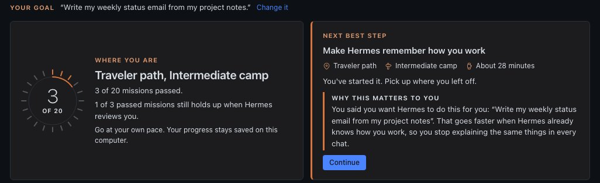

*Home.* Where you are, and the next mission to do.

## Getting it running

You need Hermes Desktop with Hermes Agent 0.22.0 or later. You install Field Academy once, on the computer where Hermes runs.

1. **Install it from Hermes Desktop.** Open [this install link](hermes://plugin/install?catalog=field-academy) and Hermes Desktop installs Field Academy for you. Or, in Hermes Desktop, click **Capabilities**, then **Plugins**, find Field Academy and click **Install**.
2. **Reload Hermes.** Restart it, or press <kbd>Ctrl</kbd>-<kbd>K</kbd> on Windows or Linux (<kbd>Cmd</kbd>-<kbd>K</kbd> on a Mac) and choose **Reload desktop plugins**.
3. **Click Field Academy** under Tools in the sidebar.
4. **Answer one question, or skip it.** Field Academy asks **What do you want Hermes to do for you?** Your answer shapes the examples you practice with. Press **Save my goal** or **Skip for now**, and change it any time.

> **Prefer the terminal?** Run this line instead of the first step. On Windows, use PowerShell. It downloads Field Academy and switches it on.
>
> ```bash
> hermes plugins install Dgardenhire/hermes-field-academy --enable
> ```

> **To remove it.** Run `hermes plugins remove field-academy`. Your progress stays saved until you delete the field-academy folder. On Windows it's in `%LOCALAPPDATA%\hermes\plugin-data`, and on a Mac or Linux it's in `~/.hermes/plugin-data`.

## The mountain

The home page is a map of Mount Olympus. Each path is a trail up the mountain, named for one of Hermes's old jobs in the Greek myths. New learners start on Messenger.

- **Messenger:** For introductions. Watch Hermes do one real job, explain it honestly, and pass a good idea to someone who can build it.
- **Traveler:** For yourself. Run Hermes on your own computer and keep one daily job working.
- **Crossroads:** For clients. Set Hermes up for a client, connect it to their tools and hand it over.
- **Boundary Keeper:** For an organization. Plan Hermes for a whole team: who owns what, who approves what, and how it recovers.
- **Guide:** For people who set up and run Hermes for a client. Fix broken setups, write a proposal, connect a real service and get your work reviewed.

The first four paths have 20 missions in all.

- Click a trail, a waypoint or a flag to open it.
- **Review queue** lists missions due for a quick review.
- **What changed since you learned this** lists missions whose lesson or check changed after you passed them. A pass always stays a pass.

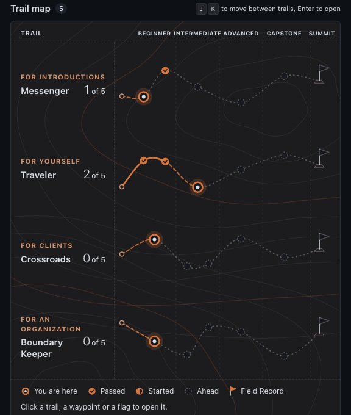

*Trail map.* Filled waypoints are passed, and the ringed one is where you are.

## Camp by camp

Every path climbs the same way, one camp at a time.

1. **Beginner.** The basics the rest of the path stands on.
2. **Intermediate.** Hermes starts doing more of the work for you.
3. **Advanced.** Hermes works without you there to ask.
4. **Capstone.** One mission on a problem of your own. You decide what success looks like before you start.
5. **The summit.** Pass every mission and you can create your Field Record for that path.

Each mission shows how long it takes and whether you've passed it. **Next** marks the one to do now.

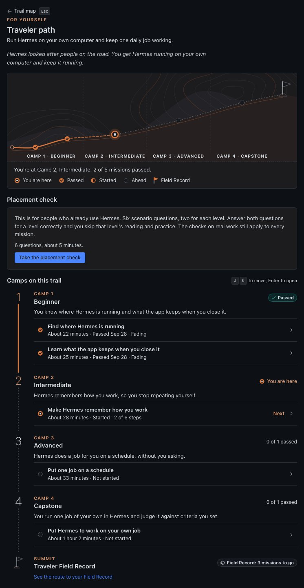

*Traveler path.* Camp 1 passed, Camp 2 in progress, and the Field Record waiting at the summit.

## Inside a mission

Every mission has six steps. You mark each one done as you go.

1. **The story.** A short story about someone using Hermes, and what they did at each turn.
2. **The takeaway.** The main idea in a few lines.
3. **Your turn.** A half-finished example. You fill in the blanks, then see the model answers beside yours.
4. **Try it.** A button opens the right page in Hermes, or starts a new chat with the practice prompt already sent.
5. **Explain it.** Answer a question in your own words. Your own Hermes scores it out of 100, and 70 passes.
6. **Prove it.** Make something real in Hermes, such as a skill, a scheduled job, a chat or a document, or look up a fact Hermes reports. Then press **Check my work** and Field Academy looks at it.

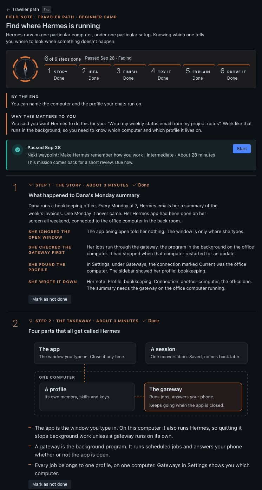

*A mission.* A story about a missing Monday email, then the four parts that all get called Hermes.

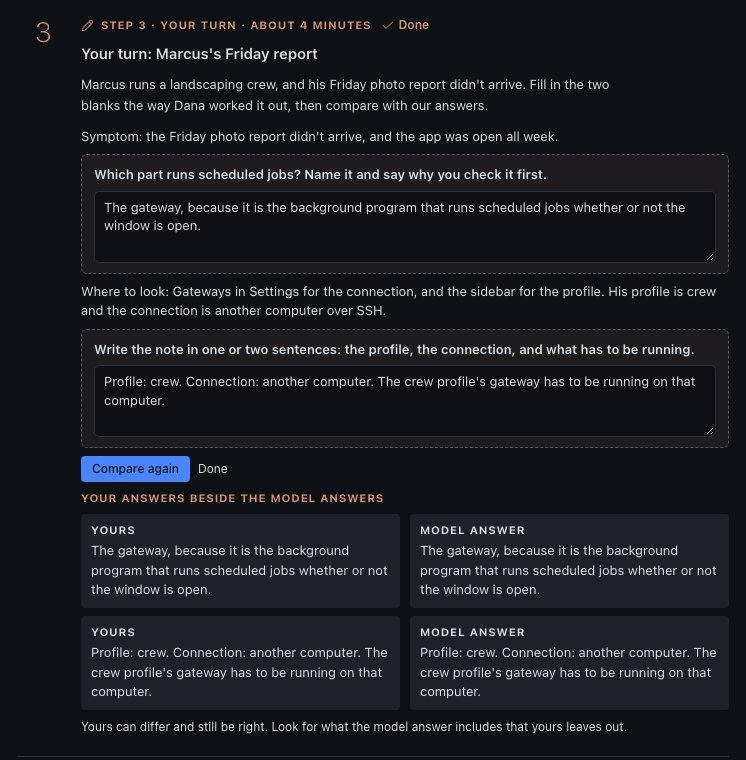

*Your turn.* Fill in the blanks first, then compare.

### Good to know

- Everything you need to pass is on the page. Extra guides and videos sit at the bottom under **Go deeper**.
- If Hermes runs on a different computer, you can paste a document into the page instead of saving it.
- Help fades as you climb. Later missions give you less of the example and more of the work.

## When a check misses

A miss tells you what's missing and gives you one hint. Miss again and you also get a worked example to follow. You can retry as many times as you like.

1. **Read What was missing.** Each line names one thing to fix, like a section that's too short.
2. **Fix the first item.**
3. **Press Check my work** again.

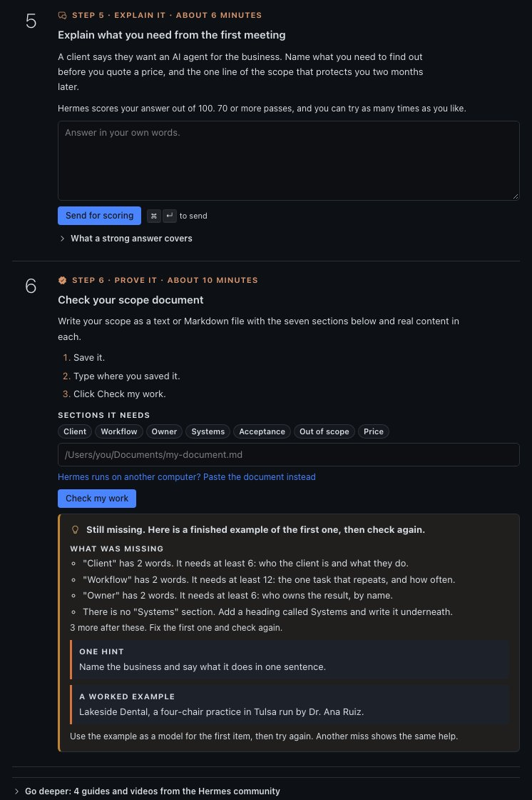

*A second miss.* What's missing, one hint and a worked example.

## Keeping it fresh

People forget what they don't use, so passed missions come back for short reviews. A review is three questions, about four minutes, scored by your own Hermes.

- **First review:** Two days after you pass a mission.
- **Answer well:** The next one waits longer: a week, then three weeks, then two months.
- **Answer poorly:** It comes back tomorrow. The mission stays passed.
- **Strength:** Each passed mission shows **Strong**, **Holding**, **Fading** or **Weak**. It slips the longer a review waits.

Press **Start a review** on the home page, or **Practice early**.

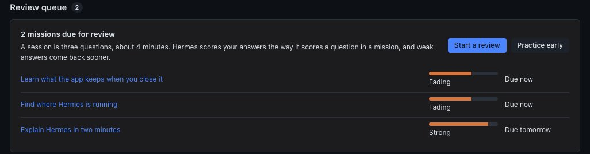

*Review queue.* Two missions due now, each with its strength.

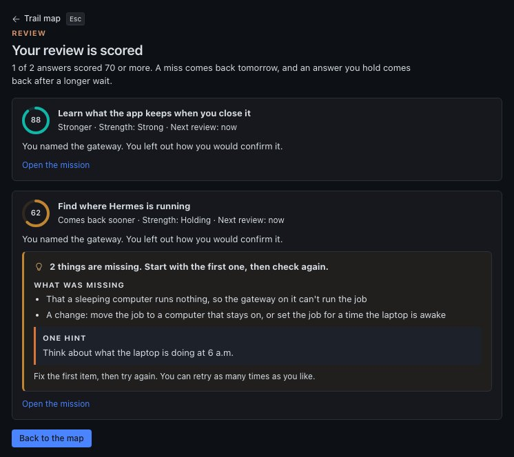

*Scored.* A weak answer shows what it missed and comes back sooner.

## Skip ahead

Already use Hermes? Each path has a placement check: six questions, two for each level, about five minutes.

1. **Open the path** and press **Take the placement check**.
2. **Answer the six questions** and press **See my result**. Each answer shows whether it was right, and why.
3. **Get both questions on a level right** and you can skip that level's reading and practice.

> **What still counts.** You still answer the question and pass the check on every mission. Your Field Record notes which missions you skipped the reading on.

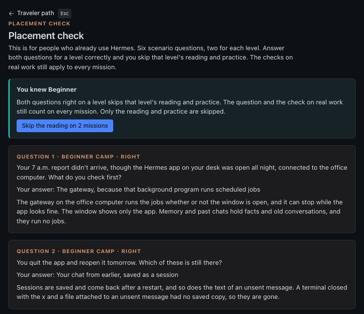

*Placement result.* Both Beginner questions right, so the Beginner reading can be skipped.

## Your Field Record

A Field Record is your own record of what you learned on a path. You create it at the summit once every mission is passed.

Every Field Record carries this line: "Self-issued with Field Academy, a community plugin for Hermes Agent. Not issued or endorsed by Nous Research."

1. **Open the path** once every mission is passed.
2. **Type your name** the way you want it on the record.
3. **Press Create your Field Record.**
4. **Press Save as a file** if you want a copy.

#### What's on it

- Your name and the date.
- What each mission's check found, and your scores.
- The name of each document you wrote, with a fingerprint that matches that exact file.
- Which missions you skipped the reading on.
- A record number.

#### What isn't

- Your written answers.
- Your chats.
- Where files sit on your computer.

### The record number

The record number is a short code made from everything on the record. Change any line and the code stops matching, and the record says so.

It catches mistakes, not cheating. Someone who changes their own data on purpose can make a new code.

Records made before version 0.8.3 were called certificates. Their record numbers still match, and the screen shows them with the new name.

## The Guide path

The Guide path asks one question: can you set up and run Hermes for a small client, like a one-person business or a three-person firm? Its four camps follow the order of a real setup.

1. **Audit.** Each lab gives you a practice folder laid out like a client's Hermes, with one problem hidden in it. Find it, fix it and write down what happened.

   - **The key in the open:** a secret key that leaked into a saved settings file.
   - **The runaway bill:** a job running every minute on an expensive AI model.
   - **Monday after the power cut:** a service that doesn't start again after a restart.

2. **Architect.** One more lab, a proposal for a made-up accounting firm, and nine hard cases with no clean answer.

3. **Build and integrate.** Connect one real service to your own Hermes, with only the access it needs, and let a scheduled job use it for at least three days.

4. **Staged verification.** Break something on purpose and show Hermes recovers. Then explain one lab the way you would to a client.

5. **The review.** A reviewer you choose, someone with the experience to judge it, scores your work and signs it. You paste their signed file into the page.

> **On Windows.** Two lab steps work a little differently on Windows, and the lab's help shows the Windows way. To lock a file so only you can read it, a Mac or Linux uses `chmod 600 .env`. On Windows, open PowerShell in the lab folder and type `icacls .env /inheritance:r /grant:r "${env:USERDOMAIN}\${env:USERNAME}:F"`. If another account is still listed after that, take it off too with `icacls .env /remove` and its name. To let a script run, a Mac or Linux uses `chmod +x`. Windows has no such setting, so the schedule line names the program that runs the script, such as `/bin/sh`. The checks and your Field Record are the same on every computer.

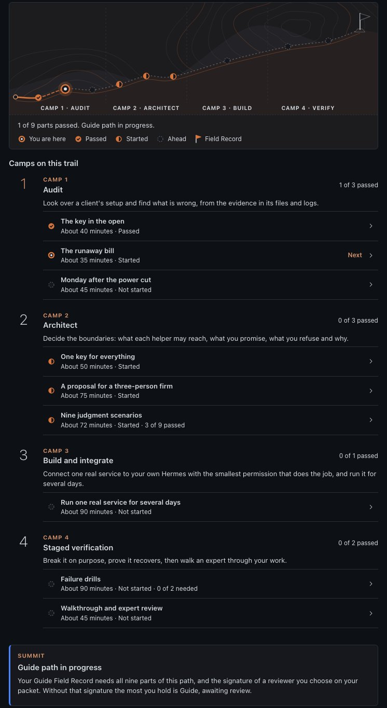

*Guide path.* Nine parts in four camps, then a reviewer you choose.

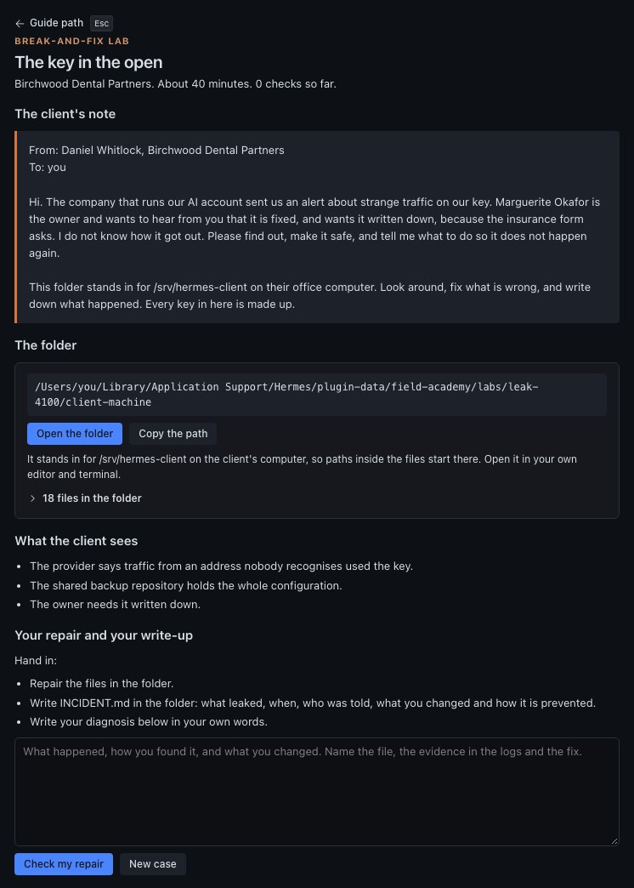

*A lab.* A client's note, a folder to fix with made-up keys, and a box for your write-up.

### Your Guide Field Record

When all nine parts pass and your reviewer's signed file is loaded, you can create your Guide Field Record. Until then, the path ends at **Guide, awaiting review**.

- Ask your reviewer for their public key, a code that lets Field Academy check their signature, and add it on the review page. Field Academy's own reviewer list is empty for now, so your record says you added the key yourself.
- The signature proves your reviewer signed your work. It doesn't mean anyone else vouches for them.
- The record shows the Hermes version you worked on. After a major Hermes update, it shows **Re-verify needed** and asks you to redo the four labs on new cases.

Each lab case is different, so copying someone else's fix won't pass on yours.

## Questions

### Do I have to copy and paste prompts?

No. When Field Academy needs Hermes to practice or score something, it opens a new chat and sends the prompt for you. On an older Hermes, it copies the prompt and you paste it.

### Who scores my answers?

Your own Hermes, with the same scoring guide every time. A 70 out of 100 passes.

### Does it send my information anywhere?

No. Field Academy has no server, no tracking and no account. Your progress is saved on the computer where Hermes runs, and your own Hermes scores your answers.

### Can someone fake a pass?

Yes, if they change their own saved data. Field Academy is a learning tool, and your record shows what passed on your own computer.

### Do I lose a pass when a lesson changes?

No. The mission shows under **What changed since you learned this** with a **Re-verify** button. Your pass stays either way.

### Can I see my progress outside the app?

Yes. Type `/academy` to Hermes in your terminal, or in a messaging app connected to Hermes, and it shows the map as plain text.

### Will updating Field Academy erase my progress?

No. Your progress is saved apart from the plugin, and it carries over from earlier versions.

### How do I start over?

Delete the field-academy folder, and Field Academy starts fresh the next time you open it. On Windows it's in `%LOCALAPPDATA%\hermes\plugin-data`, and on a Mac or Linux it's in `~/.hermes/plugin-data`.

### Is Field Academy made by Nous Research?

Field Academy is an independent plugin developed by Damon Gardenhire. It is not an official plugin for Hermes made by Nous Research.

## Credits

Field Academy links to guides and videos made by people across the Hermes community, and every link names its author. None of them have reviewed or endorsed Field Academy.

- **Nous Research**, for the [Hermes docs](https://hermes-agent.nousresearch.com/docs/), the first stop in every Go deeper list.
- **Tonbi**, Tonbi's AI Garage, for the Hermes Agent Masterclass. [hermesatlas.com/masterclass](https://hermesatlas.com/masterclass/)
- **Kevin Simback**, Hermes Atlas, for its guides to Hermes. [hermesatlas.com](https://hermesatlas.com/)
- **Tony Simons**, for The Whole Damn Thing, on how Hermes works and where it breaks. [On X](https://x.com/tonysimons_/article/2079066422211117218)
- **School of Hermes**, a concept by Damon Gardenhire, for the client-work labs. [linchpin.studio/school-of-hermes](https://linchpin.studio/school-of-hermes/)

The way Field Academy teaches draws on published research about how people learn and remember.

## Keep exploring

- **Hermes Agent** from Nous Research. [hermes-agent.nousresearch.com](https://hermes-agent.nousresearch.com)
- **The Hermes Bible**, by iamlukethedev. [hermesbible.com](https://www.hermesbible.com/)
- **Hermes Atlas**, by Kevin Simback. [hermesatlas.com](https://hermesatlas.com/)
