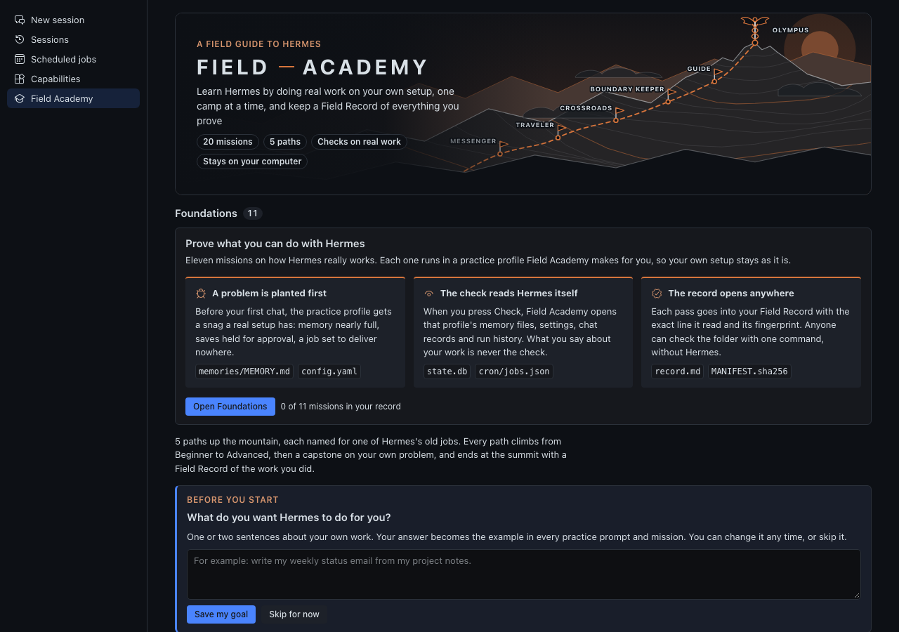
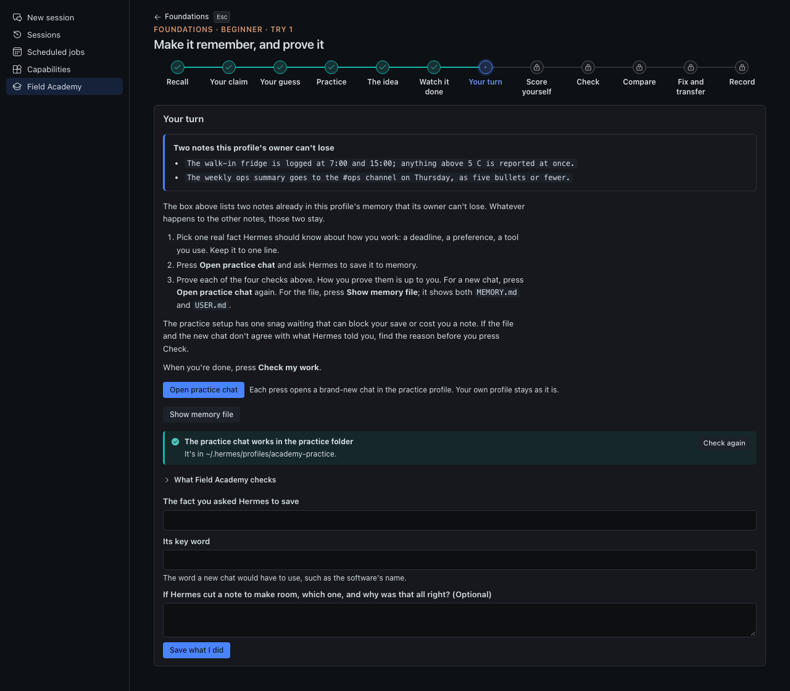
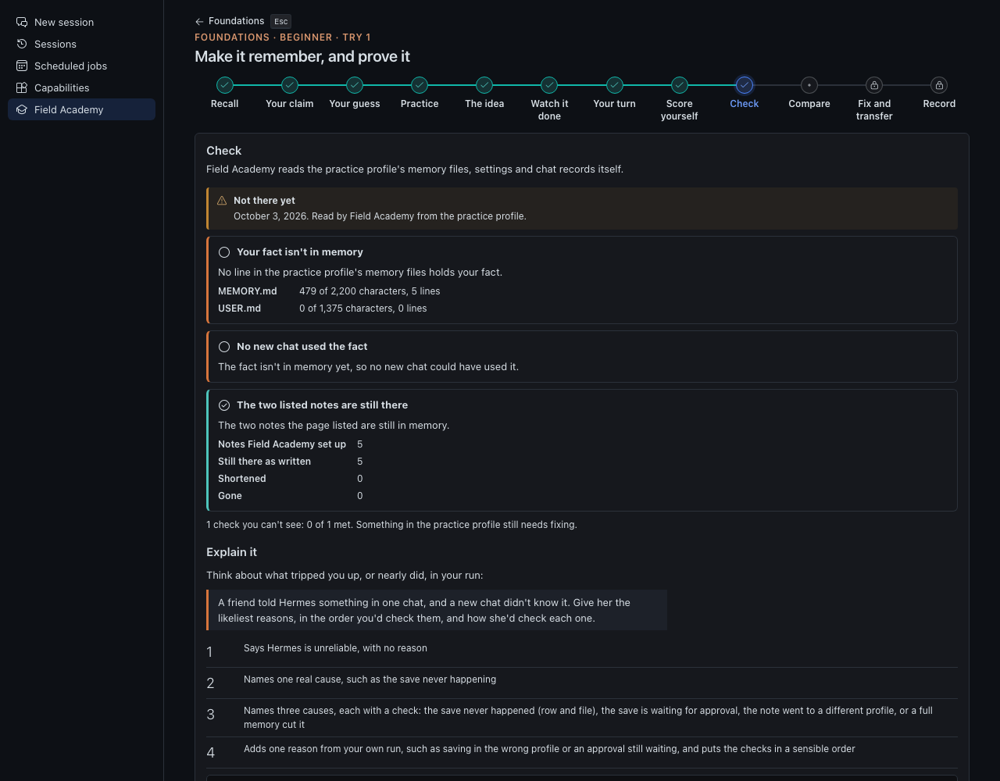
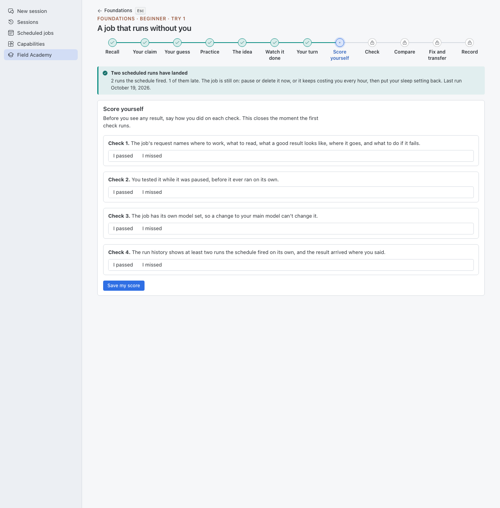
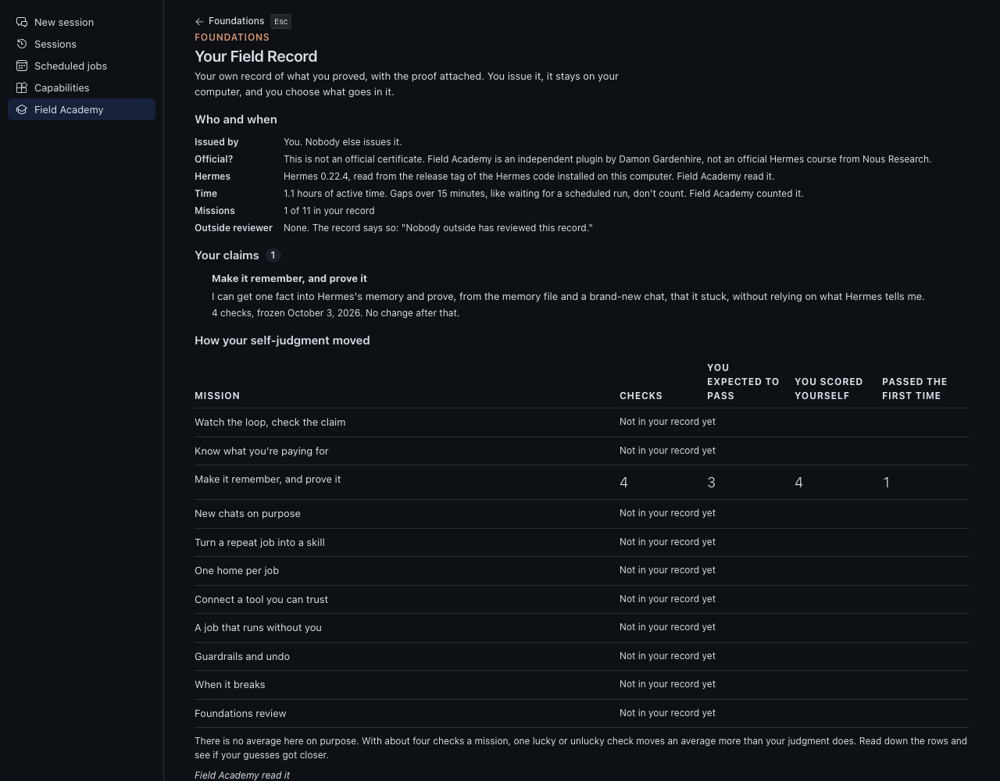

<!-- DRAFT, not submitted. Title: "plugin-catalog: bump field-academy to 0.9.0"
     Before opening: replace every PINNED_SHA with the pushed public commit, re-run both validators at that commit and
     paste the fresh output below, and confirm the test counts. Delete this comment. -->
## What does this PR do?

Bumps `field-academy` (title **Field Academy**) from 0.8.5 to 0.9.0: <https://github.com/Dgardenhire/hermes-field-academy>
(MIT), pinned to commit `PINNED_SHA`. A SHA bump is its own PR (rule 4). I own the plugin repository (rule 5).

Field Academy is an independent community plugin. It is not affiliated with Nous Research, and Nous Research has not
reviewed or endorsed it.

0.9 adds **Foundations**, eleven missions on how Hermes really works. Each one does three things a prompt can't:

- **A problem is planted first.** The mission runs in a practice profile Field Academy makes (`academy-practice`),
  and before the first chat Field Academy sets up one snag a real setup has: saves held for approval, memory nearly
  full, a scheduled job sent to a misspelled place, a second connector reaching the same folder.
- **The check reads Hermes itself.** Field Academy opens the practice profile's `MEMORY.md`, `config.yaml` (named
  keys only), `state.db`, `cron/jobs.json`, run history and logs, read-only. What the learner says about their work
  is never the check.
- **The record opens anywhere.** Each pass goes into a Field Record with the exact line read and its SHA-256, saved as
  a folder with a `MANIFEST.sha256` anyone can check with `shasum -a 256 -c`, without Hermes.



## Type of Change

- [x] Catalog entry update: version, pinned SHA, description and disclosure, screenshots

## Changes Made

- `plugin-catalog/field-academy.yaml`: `version "0.9.0"`, new `sha`, the description now covers Foundations and
  discloses what it does in practice profiles, new screenshots, `docs_url` pointed at the manual in the repo.
  `requires_hermes` stays `">=0.22.0"`: 0.9 uses nothing newer than v0.22.0 (no `ctx.files`, plugin RPC,
  `side_question` or tool media renderer).
- Capabilities are unchanged: six tools, two hooks, no middleware, no env vars.

## Rule by rule (what changed since 0.8.5)

- **3. No self-updating code:** unchanged.
- **6. Capabilities match:** `hermes plugins validate` output below.
- **8. Desktop SDK surface:** the page imports only `@hermes/plugin-sdk`, `react` and `react/jsx-runtime`. New calls
  are SDK host methods: `host.request('profiles.create')`, `host.requestProfile` (on the practice profile's own
  route from `host.profileRoutes()`), `host.newChat(profile)`, `host.deleteProfile`, and, only where present,
  `host.runDoctor` and `host.runBackup`.
- **9. No private imports:** none. The practice-profile readers locate files the way Hermes does without importing
  it (`practice.py`).
- **11. Credentials:** Field Academy never reads `.env` or `auth.json` in any profile. A new profile gets a copy of the
  user's provider sign-in from Hermes's own `profiles.create`, which is how practice chats can run; Field Academy
  never opens those files. A test watches every file open during a full run of the readers.
- **12. Approvals and unattended runs:** the plugin approves nothing and starts no processes. The jobs a mission
  plants are made paused in the practice profile through `cron.manage`, except mission 10's hourly job, whose
  misspelled delivery place makes Hermes block every run before any model call (`cron/scheduler.py`, "BLOCKED by
  pre-dispatch config validation"). Scheduled runs only ever happen in a practice profile.
- **13. Disclosure:** below, in the entry description, in `SECURITY.md` and in `docs/privacy.md`.
- **14. Truthful metadata:** `version` matches `plugin.yaml` at the pinned commit.

## Disclosure (catalog rule 13), new in 0.9

- **Practice profiles:** creates `academy-practice` and `academy-practice-b` (a number is added for a new try) through
  `profiles.create`; deletes them only when the learner confirms. Never reads or writes any other profile.
- **Writes, before a practice profile's first chat only, and refused once its backend runs:** named `config.yaml`
  keys (`terminal.cwd` set to the profile's own folder, `memory.write_approval`, `skills.write_approval`, and for
  missions 7 to 11 connector entries, `agent.disabled_toolsets`, `command_allowlist`, `fallback_providers`),
  `memories/MEMORY.md`, `memories/USER.md`, and sample files in the profile's practice folder.
- **Gateway calls into a practice profile:** `cron.manage` `add` and `pause`, `session.list`, `rollback.list`, a new
  chat, and where offered the doctor and backup.
- **Reads, read-only, practice profiles only:** memory files and held saves, named `config.yaml` keys, skills,
  `state.db` chat records and usage, `cron/jobs.json` and run history, logs, undo snapshots. Only short excerpts with
  key-shaped text removed are stored, and the learner can withhold any of them from the record.
- New in 0.9: AI help asks the learner's own model through Hermes (`ctx.llm.complete_structured`, on two auxiliary
  tasks the plugin registers), with an off switch. Field Academy still makes no network calls of its own, and holds no
  credentials, sends no telemetry, runs no shell commands, starts no background processes and never updates itself.

## How to Test

1. `git clone https://github.com/Dgardenhire/hermes-field-academy && cd hermes-field-academy && git checkout PINNED_SHA`
2. `hermes plugins validate . --install-deps` -> "Validation passed."
3. `python3 -m unittest discover -s tests` -> 1,125 tests, OK (Windows-only tests skip elsewhere; the Node
   suite, 230 tests, runs inside it when Node is installed).
4. `hermes plugins install field-academy --enable`, reload desktop plugins, open **Field Academy**, press **Open
   Foundations**, start mission 1 and press the button that makes the practice profile.
5. `REVIEWER-GUIDE.md` has a ten-minute tour, including a harness that shows every screen without installing
   anything.

## Checklist

- [x] I've read the Contributing Guide and the catalog README
- [x] My PR contains only this catalog entry
- [ ] `pytest tests/ -q`: N/A, data-only PR (the catalog CI gates run instead)
- [ ] `python3 scripts/validate_plugin_catalog.py plugin-catalog/field-academy.yaml` -> OK (run before opening)
- [x] Tests live in the plugin repository
- [x] Tested on macOS through the harness and the full suite; live run in Hermes Desktop 0.23.0: (fill in from docs/LIVE-TEST.md)

## Screenshots / Logs

| | |
|---|---|
|  |  |
|  |  |

```
VALIDATE_OUTPUT
```

## Honest limits

- A Field Record shows what passed on the learner's own computer. Someone who edits their own saved data can fake a
  pass; the fingerprints show the files didn't change after saving, not that the work was honest.
- Written answers are scored by the learner's own Hermes, so scores can vary between models.
- The lessons describe Hermes as of 0.23.0, and each fact is labelled with the version it was checked against.
- Practice chats run on the learner's own provider. Each mission states its expected cost before it starts.

🤖 Generated with [Claude Code](https://claude.com/claude-code)
